# Last version design

Screenshots of the previous Partner Portal (portal-dev), captured November 2026, kept as the baseline for the Portal redesign. See [PROJECT_DESCRIPTION.md](../PROJECT_DESCRIPTION.md) for the design review.

| # | Page | Screenshot |
| --- | --- | --- |
| 1 | Login | 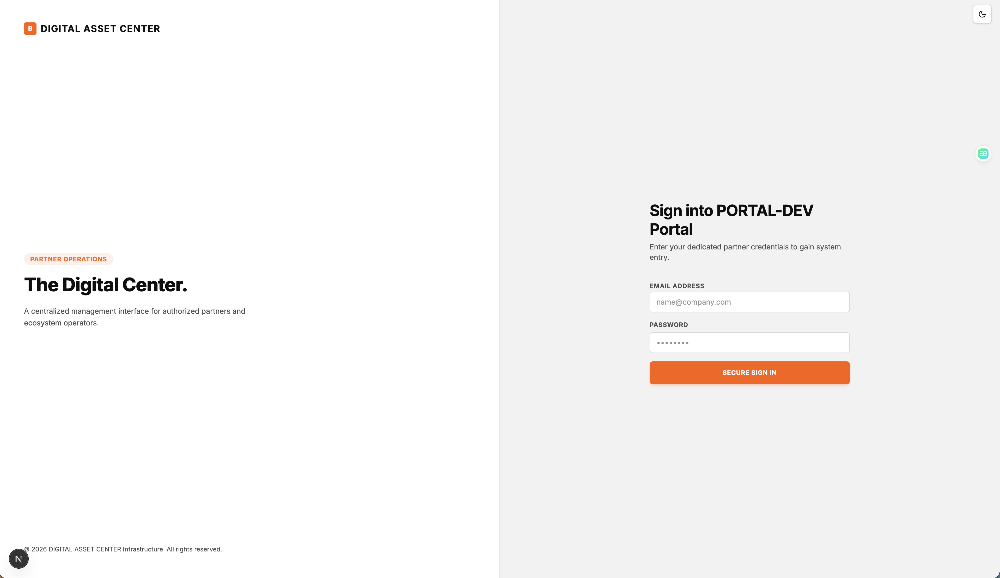 |
| 2 | Merchant overview | 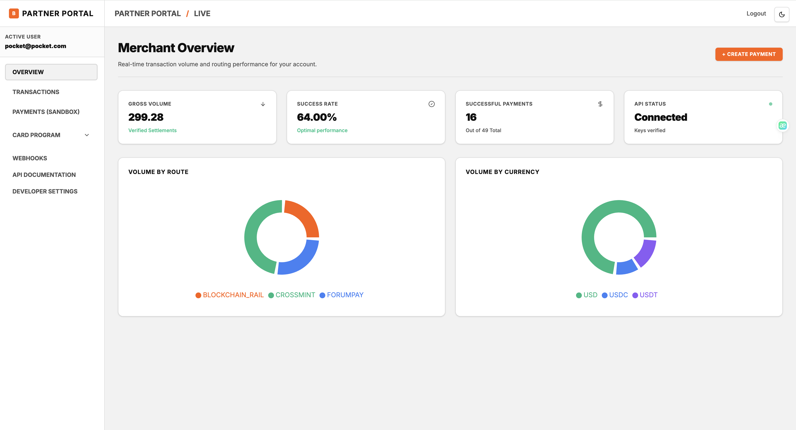 |
| 3 | Transactions | 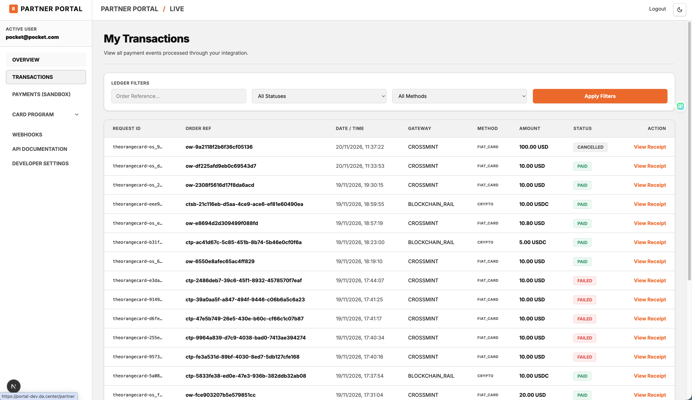 |
| 4 | Transaction receipt (status lookup) | 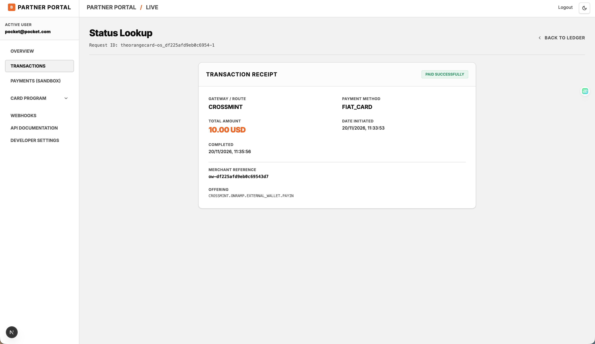 |
| 5 | Payment sandbox | 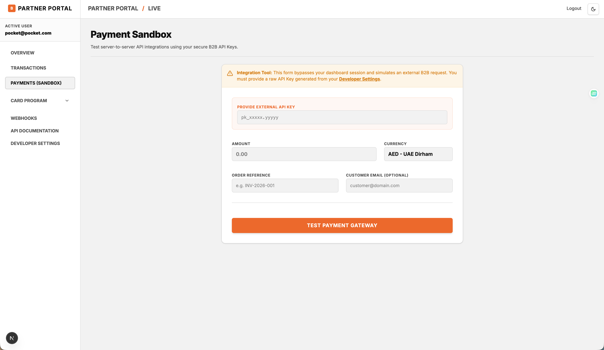 |
| 6 | Card program — Axys cards | 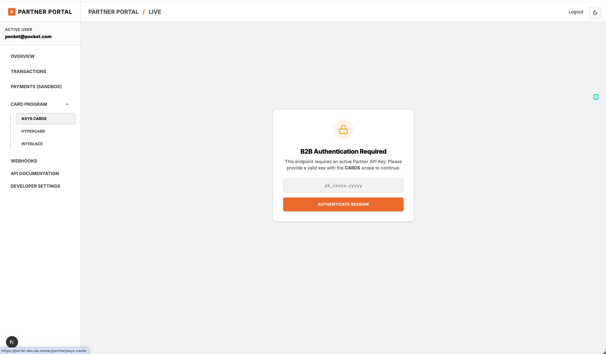 |
| 7 | Card program — Hypercard | 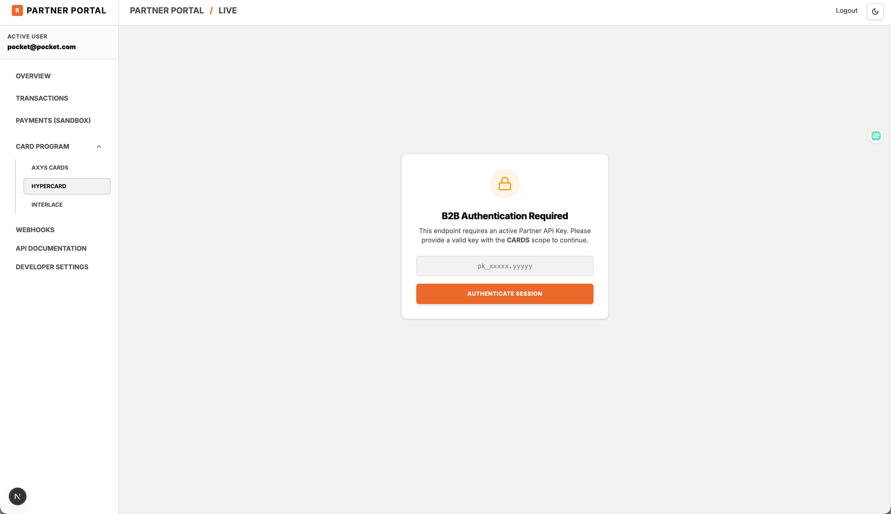 |
| 8 | Card program — Interlace | 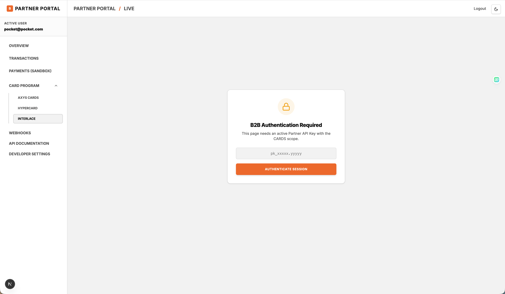 |
| 9 | Webhooks | 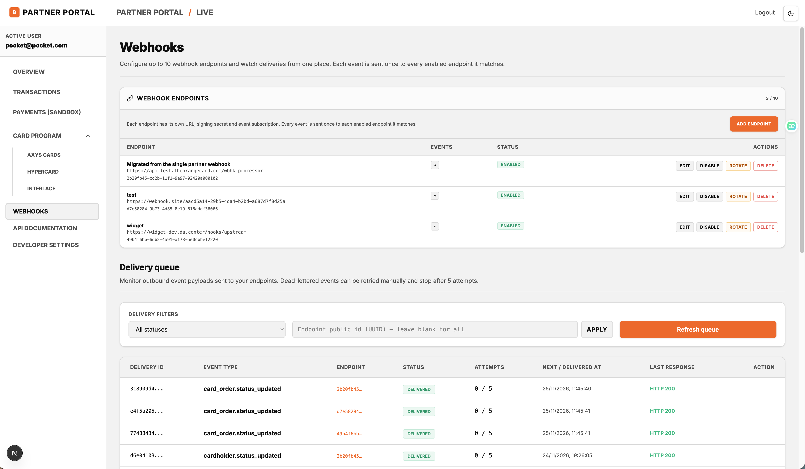 |
| 10 | API documentation | 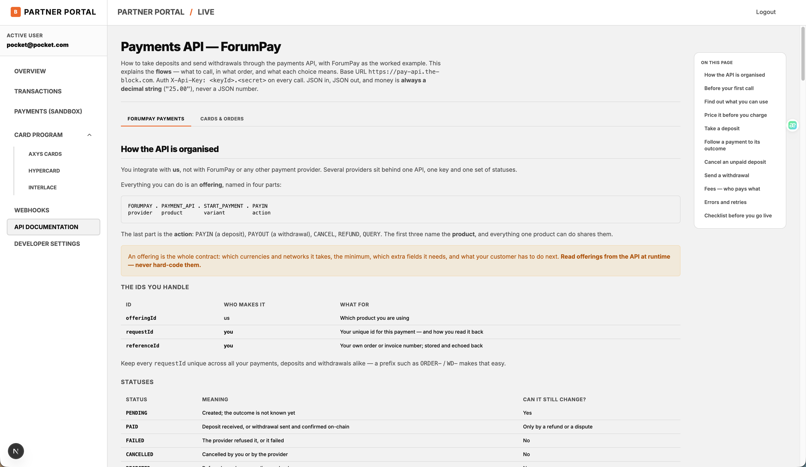 |
| 11 | Developer settings | 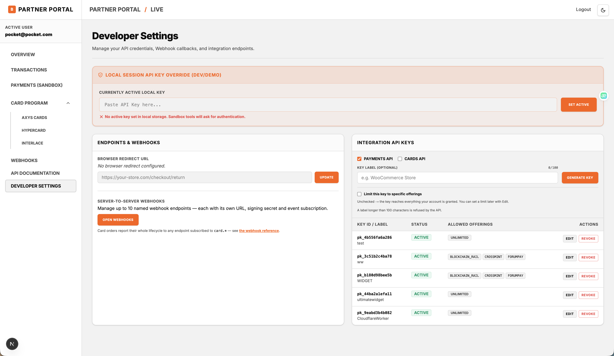 |
