# Project Description — Portal

> Onboarding guide for anyone joining the Portal redesign. It explains what the product is, who it serves, how the current version works, what we are changing, and why.

---

## 1. What Portal is

Portal is the **partner dashboard for a payment orchestration platform** (branded "Digital Asset Center" on the login screen and "Partner Portal" inside the app).

Partners — businesses such as The Orange Card — integrate **once**: one API, one API key, one set of statuses. Behind that single API the platform routes each payment to the right provider:

| Provider / route | What it handles |
| --- | --- |
| `CROSSMINT` | Fiat card payments, on-ramp to crypto (`FIAT_CARD`) |
| `FORUMPAY` | Crypto payments and withdrawals |
| `BLOCKCHAIN_RAIL` | Direct stablecoin transfers (`CRYPTO`) |

Supported currencies seen in the product today: USD, USDC, USDT, plus fiat options such as AED in the sandbox.

The API base URL is `https://pay-api.the-block.com`. Every call is authenticated with `X-Api-Key: <keyId>.<secret>`, uses JSON, and represents money as a **decimal string** (`"25.00"`), never a JSON number.

### Two product lines

1. **Payments** — deposits (pay-ins), withdrawals (payouts), cancellations, refunds and status queries.
2. **Card program** — card issuing through three issuers (**Axys**, **Hypercard**, **Interlace**): cardholders, cards and card orders. Lifecycle changes are pushed by webhook (`card_order.status_updated`, `cardholder.status_updated`).

### Offerings

Everything a partner can do is an **offering**, named in four parts:

```
FORUMPAY . PAYMENT_API . START_PAYMENT . PAYIN
provider   product       variant         action
```

Actions are `PAYIN`, `PAYOUT`, `CANCEL`, `REFUND` and `QUERY`. An offering is the full contract (accepted currencies and networks, minimums, required fields, next customer step). Integrations must read offerings from the API at runtime rather than hard-coding them.

### IDs and statuses

| ID | Created by | Purpose |
| --- | --- | --- |
| `offeringId` | Platform | Which product is being used |
| `requestId` | Partner | Unique ID per payment; used to read it back |
| `referenceId` | Partner | Partner's own order or invoice number |

| Status | Meaning | Can it still change? |
| --- | --- | --- |
| `PENDING` | Created, outcome unknown | Yes |
| `PAID` | Deposit received or withdrawal confirmed | Only via refund or dispute |
| `FAILED` | Refused or failed at the provider | No |
| `CANCELLED` | Cancelled by partner or provider | No |

---

## 2. Who uses it

| User | Main jobs |
| --- | --- |
| **Developer** at a partner company | Create API keys, test the integration, configure webhooks, read docs, debug failed calls |
| **Operations / support** | Monitor volume and success rate, look up a payment by ID, investigate failures |
| **Finance** | Reconcile settlements, export reports (not served by the current version) |
| **Partner admin** | Manage team access and security (not served by the current version) |

---

## 3. The current version (as of November 2026)

| Page | What it does today |
| --- | --- |
| **Login** | Email and password sign-in, split layout with brand panel |
| **Overview** | Gross volume, success rate, successful payments, API status, volume by route and by currency (donuts) |
| **Transactions** | Ledger table with filters (order reference, status, method) and a "View receipt" link per row |
| **Receipt ("Status lookup")** | Gateway, method, amount, dates, merchant reference, offering |
| **Payments (Sandbox)** | Form that simulates a server-to-server payment using a pasted API key |
| **Card program → Axys / Hypercard / Interlace** | Each shows a locked screen asking for an API key with `CARDS` scope |
| **Webhooks** | Up to 10 endpoints (URL, signing secret, event subscription) plus a delivery queue with retries (max 5 attempts) |
| **API documentation** | Long-form guide (ForumPay payments, cards and orders) with an on-page table of contents |
| **Developer settings** | Local API key override (dev/demo), browser redirect URL, link to webhooks, integration API key list |

---

## 4. Design review — problems to solve

### 4.1 Identity and environment
- The product has three names: "Digital Asset Center", "PORTAL-DEV Portal" and "Partner Portal".
- The breadcrumb says **LIVE** while the same app contains a Sandbox page and a "dev/demo" key override. In a payments product, users must always know whether they are touching real money.

### 4.2 Visual system
- Almost all text is uppercase (navigation, labels, buttons, table headers), so nothing stands out.
- Orange is used for primary buttons, links, amounts, IDs, warnings and the "Rotate" action. Actions and data look the same.
- Several warning panels use orange and amber backgrounds that compete with the brand color.

### 4.3 Overview
- Gross volume shows no currency and appears to add USD and USDC together.
- No time range is shown.
- "64% success rate — Optimal performance" sits next to "16 out of 49 total" (about 33%). The metric definitions need to be checked with engineering.
- The donuts show shares but no values; there is no trend over time, recent activity or list of problems.

### 4.4 Transactions and receipt
- The request ID (the most useful lookup key) is truncated, while the order reference takes a wide column.
- No date range filter, export or visible pagination; amounts are not right-aligned; failed rows give no reason.
- The receipt has no event timeline, failure reason, fees, net amount, provider reference, related webhooks, raw payload, copy buttons, or refund and cancel actions.

### 4.5 Card program
- Navigation is organized by issuer (vendor), not by task. All three pages are identical dead ends.

### 4.6 Developer area
- Webhooks are reachable from two places.
- The "local session API key override" is an internal dev tool exposed as a product feature, and pasting raw keys into the browser is a security concern.
- Every webhook row shows four buttons, including an inline Delete.
- Event subscriptions are shown as a bare `*`.
- API keys lack "created" and "last used" data, a reveal-once secret flow and a revoke confirmation.

### 4.7 Login
- The left half of the screen is mostly empty.

---

## 5. Design principles for the redesign

1. **Always show the environment.** One Live/Test switch in the top bar and a visible banner in Test mode.
2. **One primary action per screen.** Orange is reserved for that action; status uses a separate semantic palette (success, warning, danger, neutral).
3. **Sentence case.** Uppercase only for small overline labels.
4. **Numbers need context.** Every metric shows currency, time range and comparison to the previous period.
5. **Organize by task, not by vendor.** Providers and issuers are filters, not navigation items.
6. **Every ID is copyable, and every list is searchable.**
7. **Destructive actions are confirmed** and live in overflow menus.

---

## 6. Proposed information architecture

```mermaid
graph TD
  Shell[Portal shell<br/>Live/Test toggle · Search · Account] --> Home
  Shell --> Payments
  Shell --> Cards
  Shell --> Developers
  Shell --> Reports
  Shell --> Settings

  Home --> H1[Overview]
  Home --> H2[Getting started]
  Home --> H3[Alerts]

  Payments --> P1[Transactions]
  Payments --> P2[Payment detail]
  Payments --> P3[Payouts]
  Payments --> P4[Refunds]
  Payments --> P5[Balances]

  Cards --> C1[Program overview]
  Cards --> C2[Cardholders]
  Cards --> C3[Cards]
  Cards --> C4[Card orders]
  Cards --> C5[Issuers]

  Developers --> D1[API keys]
  Developers --> D2[Webhooks]
  Developers --> D3[Event and API logs]
  Developers --> D4[API explorer]
  Developers --> D5[Docs]

  Reports --> R1[Exports]
  Reports --> R2[Statements]
  Reports --> R3[Reconciliation]

  Settings --> S1[Organization]
  Settings --> S2[Team and roles]
  Settings --> S3[Security]
  Settings --> S4[Checkout redirects]
  Settings --> S5[Notifications]
```



**Account access** (outside the shell): Sign in · Two-factor · Reset password · Accept invite.

### Mapping from current to proposed

| Current page | Proposed location |
| --- | --- |
| Overview | Home → Overview |
| Transactions / Receipt | Payments → Transactions, with Payment detail as a side drawer |
| Payments (Sandbox) | Removed — replaced by Test mode and Developers → API explorer |
| Card program → Axys / Hypercard / Interlace | Cards section, with issuer as a filter; Issuers page for connection status |
| Webhooks | Developers → Webhooks |
| API documentation | Developers → Docs |
| Developer settings | Split into Developers → API keys and Settings → Checkout redirects; key override removed |

---

## 7. New flows to design

| Flow | Summary |
| --- | --- |
| **Onboarding checklist** | Create test key → make test payment → add webhook and send test event → request go-live |
| **Failed payment investigation** | Alert on Overview → filtered Transactions → detail drawer with reason, timeline and provider response → retry or contact support |
| **Refund and cancel** | Actions on payment detail with confirmation showing amount and fee |
| **API key lifecycle** | Name → scope (Payments, Cards, specific offerings) → reveal secret once → rotate or revoke with confirmation and last-used info |
| **Webhook debugging** | Send test event, inspect request and response, retry dead-lettered deliveries |
| **Team and roles** | Invite members as admin, developer, finance or viewer; finance never sees keys |
| **Global search (Cmd+K)** | Paste a request ID, order reference, card ID or email and jump to the record |
| **Alerts** | Thresholds such as success rate drop or failing endpoint, delivered by email or in-app |
| **Card program access** | Explain missing `CARDS` scope and link directly to creating a key with that scope |

---

## 8. Suggested delivery order

1. Navigation shell and design tokens (color roles, type scale, spacing, components)
2. Home → Overview
3. Payments → Transactions and Payment detail drawer
4. Developers → API keys and Webhooks
5. Cards section
6. Reports, Settings and Account access

---

## 9. Open questions

- Should Portal follow The Orange Card design system or have its own neutral Digital Asset Center identity?
- How exactly are success rate and gross volume calculated (which statuses count, how multiple currencies are combined)?
- Which roles and permissions does the backend support today?
- Is Test mode backed by separate test keys and data on the API side?

---

## 10. Glossary

| Term | Meaning |
| --- | --- |
| **Orchestration** | Routing one partner request to the right underlying provider |
| **Offering** | A specific provider + product + variant + action contract |
| **Pay-in / Payout** | Deposit from a customer / withdrawal to a customer |
| **Route / Gateway** | The provider that processed a payment |
| **Dead-lettered** | A webhook delivery that failed all automatic retries |
| **Scope** | What an API key is allowed to access (e.g. Payments, Cards) |
