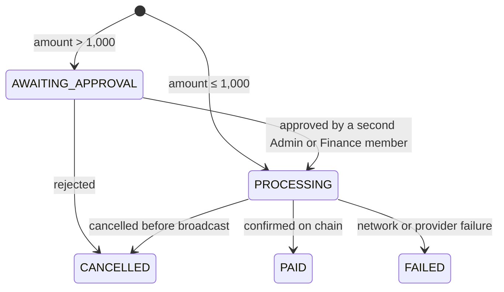

# Portal API specification

For the backend team. This document lists the REST API that the Portal dashboard needs, so the prototype's sample data (`pages/js/data/*.js`) can be replaced with real calls. It covers the partner API that already exists (`/payments`, `/offerings`, …) and the endpoints that only the dashboard uses (team, settings, sessions, support).

Every example below is taken from the sample data shapes in the prototype. Field names in the examples are the API's names. Where the prototype uses a shorter name (for example `ref` instead of `referenceId`), the mapping is listed in [Replacing the sample data](#16-replacing-the-sample-data).

## Contents

1. [Overview](#1-overview)
2. [Authentication](#2-authentication)
3. [Conventions](#3-conventions)
4. [Lists: pagination, filters and sorting](#4-lists-pagination-filters-and-sorting)
5. [Errors and rate limits](#5-errors-and-rate-limits)
6. [Test and Live environments](#6-test-and-live-environments)
7. [Roles and permissions](#7-roles-and-permissions)
8. [Endpoints by page](#8-endpoints-by-page)
   - [8.1 Current user and auth](#81-current-user-and-auth)
   - [8.2 Overview](#82-overview)
   - [8.3 Payments](#83-payments)
   - [8.4 Refunds](#84-refunds)
   - [8.5 Payouts and balances](#85-payouts-and-balances)
   - [8.6 Cardholders and cards](#86-cardholders-and-cards)
   - [8.7 Card orders](#87-card-orders)
   - [8.8 Issuers](#88-issuers)
   - [8.9 Reports: exports, statements, reconciliation](#89-reports-exports-statements-reconciliation)
   - [8.10 API keys](#810-api-keys)
   - [8.11 Webhooks](#811-webhooks)
   - [8.12 Event logs and request logs](#812-event-logs-and-request-logs)
   - [8.13 Docs: offerings, go-live checklist](#813-docs-offerings-go-live-checklist)
   - [8.14 Team, invites and roles](#814-team-invites-and-roles)
   - [8.15 Settings](#815-settings)
   - [8.16 Support and system status](#816-support-and-system-status)
   - [8.17 Search](#817-search)
9. [Webhook events](#9-webhook-events)
10. [Webhook signatures](#10-webhook-signatures)
11. [Validation rules](#11-validation-rules)
12. [Security requirements](#12-security-requirements)
13. [Audit log](#13-audit-log)
14. [Endpoint summary](#14-endpoint-summary)
15. [Open questions for the backend](#15-open-questions-for-the-backend)
16. [Replacing the sample data](#16-replacing-the-sample-data)

---

## 1. Overview

| Item | Value |
| --- | --- |
| Base URL | `https://pay-api.the-block.com` |
| Format | JSON in and out (`Content-Type: application/json`), UTF-8 |
| Money | Decimal strings, for example `"25.00"`. Never JSON numbers |
| Time | ISO 8601 in UTC with a `Z` suffix, for example `"2026-11-27T10:42:00Z"` |
| Partner auth | `X-Api-Key: <keyId>.<secret>` |
| Dashboard auth | Session cookie plus CSRF token |
| Environments | Test and Live, fully separate keys and data |

Paths in this document are relative to the base URL and match the paths the partner API already uses (for example `POST /payments`). If the API adds a version prefix later, it applies to every path here.

There is one API. Most resources (payments, refunds, payouts, cards, reports) accept both kinds of auth. Resources that only make sense for people (team, settings, sessions, support, API key management, webhook management) accept the dashboard session only. Each endpoint below lists which auth it accepts.

## 2. Authentication

### 2.1 Partner server keys

Partners call the API from their servers with:

```http
X-Api-Key: pk_live_8c21d0b94f2a.Xq3…40 characters…
```

- The part before the dot is the key ID (`pk_live_…` or `pk_test_…`). It is not secret and appears in logs and in the dashboard.
- The part after the dot is the secret (40 characters, base62). The API stores only a hash of it (for example Argon2id or HMAC-SHA256 with a server pepper). It is returned once, at creation or rotation, and never again.
- A key has **scopes** (`payments`, `cards`, `reports`), an optional **offering restriction** (a list of offering IDs) and an optional **IP allowlist** (IPv4 addresses or CIDR ranges). A request outside these fails with `403`.
- The key's prefix sets the environment. A `pk_test_` key can only reach Test data.
- Keys never authenticate dashboard-only endpoints.

### 2.2 Dashboard session

People sign in to Portal in the browser. The session is a cookie:

```http
Set-Cookie: portal_session=<opaque>; Path=/; HttpOnly; Secure; SameSite=Strict; Max-Age=3600
```

- `HttpOnly`, `Secure` and `SameSite=Strict` are required. The prototype never stores tokens in `localStorage`.
- The lifetime follows Settings → Security → Session timeout (15 minutes to 8 hours, default 1 hour). It is an idle timeout, renewed on activity.
- **CSRF:** every state-changing request (`POST`, `PUT`, `PATCH`, `DELETE`) with session auth must send `X-CSRF-Token`. The token comes from `GET /me` (field `csrfToken`) and is bound to the session. The server rejects a missing or wrong token with `403 CSRF_TOKEN_INVALID`. The server should also check `Origin` against the dashboard host.
- **Recent authentication:** some actions need the user to have entered their password or 2FA code in the last 10 minutes: creating, rotating or revoking API keys, revealing a webhook signing secret, changing roles, disabling 2FA, approving payouts and closing the account. If not, the server replies `403 REAUTH_REQUIRED`, and the dashboard asks for the 2FA code and calls `POST /auth/reauth`.
- The dashboard is served from a different origin than the API, so the API sends CORS headers that allow only the dashboard origin, with `Access-Control-Allow-Credentials: true`.

### 2.3 Which auth each endpoint accepts

| Group | Server key | Session |
| --- | --- | --- |
| Payments, refunds, payouts (create, read, cancel) | Yes, `payments` scope | Yes |
| Payout approval | No | Yes |
| Cardholders, cards, card orders, issuers (read, test connection) | Yes, `cards` scope | Yes |
| Exports, statements, settlements | Yes, `reports` scope | Yes |
| Offerings | Yes, any scope | Yes |
| Overview metrics, search, logs, events | No | Yes |
| API keys, webhooks, team, settings, sessions, support, go-live | No | Yes |

## 3. Conventions

### 3.1 Money

- Amounts are strings with exactly two decimals: `"25.00"`, `"1850.75"`. Parse them with a decimal type, not a float.
- Every amount travels with its `currency` (`USD`, `USDC`, `USDT`, `AED`).
- Amounts in different currencies are never added together unless the field says so. Totals that combine currencies are named `…UsdEquivalent` and come with the conversion rule (see [open questions](#15-open-questions-for-the-backend)).

### 3.2 Time

- Timestamps are ISO 8601 UTC strings ending in `Z`.
- Dates without time (export ranges) are `YYYY-MM-DD` and are inclusive on both ends, in UTC.
- Months (statements) are `YYYY-MM`.

### 3.3 IDs

IDs are opaque strings with a type prefix, so a pasted ID tells the dashboard (and ⌘K search) what it is.

| Prefix | Object | Example |
| --- | --- | --- |
| `req_` | Payment (the `requestId`) | `req_8f3a91c2e7` |
| `rf_` | Refund | `rf_3b1c9e0a47` |
| `po_` | Payout | `po_a41f0c2e9b` |
| `ch_` | Cardholder | `ch_5e1a02bc9d44` |
| `card_` | Card | `card_91b0e4d2a7c3` |
| `co_` | Card order | `co_7e20a1b9c4d5` |
| `pk_live_`, `pk_test_` | API key ID | `pk_live_8c21d0b94f2a` |
| `we_` | Webhook endpoint | `we_1a2b3c4d5e6f70` |
| `evt_` | Event | `evt_0c9d8e7f6a5b` |
| `dl_` | Webhook delivery | `dl_4e5f6a7b8c9d` |
| `rq_` | Logged API request | `rq_9a8b7c6d5e4f30` |
| `exp_` | Export | `exp_7d21c0a9f3` |
| `stl_` | Settlement batch | `stl_cm_20261126` |
| `usr_` | Team member | `usr_03` |
| `inv_` | Invite | `inv_01` |
| `ses_` | Signed-in session | `ses_01` |
| `TKT-` | Support ticket | `TKT-2041` |
| `whsec_` | Webhook signing secret (value, not an ID) | `whsec_…` |

Partner-supplied references keep their own format: `referenceId` (for example `ORD-10492`) and the payout `reference` (for example `WD-2060`).

`requestId` is created by the partner on `POST /payments`. When a payment is created from the dashboard, the server generates it.

### 3.4 Enumerations

Enumerations are uppercase strings in the API (`PAID`, `AWAITING_APPROVAL`). The prototype uses lowercase (`paid`, `awaiting_approval`) and displays them in sentence case. The dashboard lowercases on read.

| Object | Statuses |
| --- | --- |
| Payment | `PENDING`, `PAID`, `FAILED`, `CANCELLED`, `REFUNDED`, `PARTIALLY_REFUNDED` |
| Refund | `PENDING`, `SUCCEEDED`, `FAILED` |
| Payout | `AWAITING_APPROVAL`, `PROCESSING`, `PAID`, `FAILED`, `CANCELLED` |
| Cardholder KYC | `PENDING`, `VERIFIED`, `REJECTED` |
| Cardholder | `ACTIVE`, `SUSPENDED` |
| Card | `ACTIVE`, `FROZEN` |
| Card order | `REQUESTED`, `PROCESSING`, `SHIPPED`, `ACTIVE`, `FAILED`, `CANCELLED` |
| Issuer connection | `CONNECTED`, `NEEDS_SCOPE`, `DISCONNECTED` |
| API key | `ACTIVE`, `REVOKED` |
| Webhook endpoint | `ACTIVE`, `FAILING`, `DISABLED` |
| Webhook delivery | `DELIVERED`, `RETRYING`, `DEAD` |
| Export | `GENERATING`, `READY`, `EXPIRED` |
| Statement | `OPEN` (month to date), `CLOSED` (final) |
| Settlement batch | `MATCHED`, `MISMATCH`, `RESOLVED` |
| Support ticket | `OPEN`, `WAITING` (on the partner), `CLOSED` |

### 3.5 Idempotency

Every `POST` that creates or moves money or objects accepts `Idempotency-Key` (a UUID v4 from the client, up to 64 characters).

- The server stores the key with the request hash and response for 24 hours, per environment and per key or user.
- A retry with the same key and the same body returns the original response with `Idempotent-Replayed: true`.
- The same key with a different body returns `409 IDEMPOTENCY_KEY_REUSED`.
- The dashboard sends a new key each time a user confirms an action, and reuses it if it retries after a network error.

`POST /payments` is also idempotent on `requestId`: a second payment with a used `requestId` fails with `409 DUPLICATE_REQUEST_ID`.

### 3.6 Object envelope

Single objects are returned as the object itself, with an `object` field naming the type:

```json
{ "object": "payment", "requestId": "req_8f3a91c2e7", "status": "PAID" }
```

Lists use the envelope in [section 4](#4-lists-pagination-filters-and-sorting).

### 3.7 Expanding related data

Detail endpoints return the related data each drawer shows (timeline, webhooks, cards) inline. List endpoints return the fields the table needs plus the detail fields that are cheap. When a list is too heavy, the dashboard calls the detail endpoint when a drawer opens.

## 4. Lists: pagination, filters and sorting

### 4.1 Cursor pagination

```http
GET /payments?limit=25&starting_after=req_5d4410ee09
```

| Parameter | Meaning |
| --- | --- |
| `limit` | 1 to 100, default 25 |
| `starting_after` | ID of the last item on the previous page |
| `ending_before` | ID of the first item on the current page, to go back |

```json
{
  "object": "list",
  "data": [ { "object": "payment", "requestId": "req_2ab9c3d871" } ],
  "hasMore": true,
  "totalCount": 64,
  "counts": { "all": 64, "paid": 33, "pending": 7, "failed": 9, "refunded": 6 }
}
```

- `totalCount` is the number of items that match the filters. The dashboard shows "1–12 of 64". It may be capped for large lists (`"totalCount": 10000, "totalCountCapped": true`).
- `counts` is returned on lists that have a status segmented control (payments, refunds, payouts, card orders, cardholders, request logs). It counts every status **with all other filters applied**, so the numbers beside each segment are correct.

### 4.2 Filters

Toolbar filters map to plain query parameters. Every list accepts:

| Parameter | Use | Example |
| --- | --- | --- |
| `q` | Free search across the IDs and text columns of that list (contains, case-insensitive, up to 80 characters) | `q=ORD-10489` |
| `status` | One or more statuses, comma-separated | `status=failed,pending` |
| `created[gte]`, `created[lte]` | Date range | `created[gte]=2026-10-28T00:00:00Z` |
| `range` | Shortcut for the toolbar date select: `7d`, `30d`, `90d`, `all` | `range=30d` |

Each list adds its own named filters (for example `route`, `method`, `issuer`, `kyc`, `type`, `env`), listed with each endpoint.

### 4.3 Column filters

Table headers in the dashboard have column filters. Each column filter maps to a query parameter on the field, with an operator in brackets:

| Column type | Operators | Example |
| --- | --- | --- |
| Text | `[contains]` (case-insensitive) | `customer[contains]=ava@` |
| Number or money | `[gte]`, `[lte]` (min and max, inclusive, decimal strings) | `amount[gte]=10.00&amount[lte]=100.00` |
| Date | `[gte]`, `[lte]` (from and to, ISO 8601 or `YYYY-MM-DD`, inclusive) | `created[gte]=2026-11-01&created[lte]=2026-11-26` |
| Options | `[in]`, comma-separated | `currency[in]=USD,USDC` |

Rules:

- Filters combine with AND. Options inside one `[in]` combine with OR.
- Values are URL-encoded. A `[contains]` value is matched literally; the server escapes `%` and `_` before using it in SQL `LIKE`.
- Money comparisons ignore currency unless `currency` is also filtered. The dashboard shows a hint when the user filters an amount across several currencies.
- Unknown fields or operators fail with `400 INVALID_FILTER` and name the parameter, so filter bugs are caught early.
- The filterable fields for each list are listed with its endpoint.

### 4.4 Sorting

```http
GET /payments?sort=-created
GET /payments?sort=amount
```

`sort` takes one field. A leading `-` means descending. Default is `-created` on every list. Sortable fields are listed with each endpoint. Cursor pagination stays stable under any sort (the server adds the ID as a tie-breaker).

## 5. Errors and rate limits

### 5.1 Error envelope

Every error has the same shape:

```json
{
  "error": {
    "status": 422,
    "code": "AMOUNT_BELOW_MINIMUM",
    "message": "The minimum for this offering is 5.00 USDT.",
    "field": "amount",
    "requestId": "rq_9a8b7c6d5e4f30",
    "docUrl": "https://pay-api.the-block.com/docs/errors#AMOUNT_BELOW_MINIMUM"
  }
}
```

- `code` is stable and machine-readable. The dashboard maps it to copy; `message` is a plain-English fallback written for the user, in sentence case.
- `field` is present for validation errors, so the dashboard can place the message under the right input (`Portal.fieldError`). For several invalid fields, `errors` holds a list of `{ field, code, message }`.
- `requestId` here is the `rq_` ID of the logged request, shown in Event logs. It is also sent as the `Request-Id` response header on every response.
- The prototype's API explorer and request log use a shorter shape (`{ "code", "message" }` and `{ "error": { "code": 404, "message" } }`). The envelope above replaces both.

### 5.2 Error codes

| HTTP | Code | When |
| --- | --- | --- |
| 400 | `VALIDATION_ERROR` | Missing or malformed field |
| 400 | `INVALID_FILTER` | Unknown filter field or operator |
| 401 | `INVALID_API_KEY` | Unknown, revoked or malformed key |
| 401 | `SESSION_EXPIRED` | Session cookie missing or timed out |
| 403 | `MISSING_SCOPE` | Key lacks the scope (for example `cards`). The message names the scope |
| 403 | `OFFERING_NOT_ALLOWED` | Key is restricted to other offerings |
| 403 | `IP_NOT_ALLOWED` | Caller IP not in the key's or organization's allowlist |
| 403 | `PERMISSION_DENIED` | The user's role does not allow this action |
| 403 | `CSRF_TOKEN_INVALID` | Missing or wrong CSRF token |
| 403 | `REAUTH_REQUIRED` | Action needs recent password or 2FA |
| 403 | `LIVE_NOT_ENABLED` | Live mode not yet approved (go-live pending) |
| 404 | `NOT_FOUND`, `PAYMENT_NOT_FOUND` | Object does not exist in this environment |
| 409 | `DUPLICATE_REQUEST_ID` | `requestId` already used |
| 409 | `PAYMENT_NOT_CANCELLABLE` | Payment is not `PENDING` |
| 409 | `PAYMENT_NOT_REFUNDABLE` | Payment is not `PAID` or already fully refunded |
| 409 | `PAYOUT_NOT_CANCELLABLE` | Payout already broadcast |
| 409 | `SELF_APPROVAL_NOT_ALLOWED` | Approver is the requester |
| 409 | `ENDPOINT_LIMIT_REACHED` | Already 10 webhook endpoints |
| 409 | `IDEMPOTENCY_KEY_REUSED` | Same key, different body |
| 422 | `AMOUNT_BELOW_MINIMUM` | Below the offering or payout minimum |
| 422 | `INSUFFICIENT_BALANCE` | Payout larger than the balance |
| 422 | `REFUND_EXCEEDS_PAYMENT` | Refund larger than the refundable amount |
| 422 | `OFFERING_UNAVAILABLE` | Offering not enabled for this partner, or wrong action |
| 422 | `CARDHOLDER_NOT_VERIFIED` | Card order for a cardholder without verified KYC |
| 422 | `INVALID_ADDRESS` | Wallet address does not match the network |
| 429 | `RATE_LIMITED` | See below |
| 500 | `INTERNAL_ERROR` | Unexpected server error |
| 502 | `PROVIDER_UNAVAILABLE` | Crossmint, ForumPay, rail or issuer did not answer |
| 503 | `SERVICE_UNAVAILABLE` | Maintenance or overload |

### 5.3 Rate limits

| Caller | Limit (proposal) |
| --- | --- |
| Server key, Live | 100 requests per second per key, burst 200 |
| Server key, Test | 25 requests per second per key |
| Dashboard session | 20 requests per second per user |
| Sign-in, 2FA, password reset | 5 attempts per 15 minutes per account and per IP |
| Exports | 5 export jobs at a time per organization |

Every response carries `RateLimit-Limit`, `RateLimit-Remaining` and `RateLimit-Reset` (seconds). A `429` adds `Retry-After`. The sidebar meter "API requests 18.6k of 20.0k" reads the monthly quota from `GET /me/usage`. The UI turns it amber from 75% and red from 90%, so the response should return `used` and `limit` as integers; thresholds stay client-side (see [8.1](#81-current-user-and-auth)).

## 6. Test and Live environments

The dashboard has a Test mode switch in the header. Test and Live are separate on the server, not just a flag on records:

- **Separate keys:** `pk_test_…` keys only reach Test data; `pk_live_…` keys only reach Live data.
- **Separate data:** payments, refunds, payouts, cardholders, cards, orders, webhooks, events, logs, exports and balances exist per environment. An ID from one environment returns `404` in the other.
- **Separate webhook endpoints and signing secrets.**
- **Shared:** organization, team, roles, settings, sessions and support tickets.
- **Dashboard requests** state the environment in a header: `Portal-Environment: test` or `live`. It is required on every environment-scoped endpoint. A missing header fails with `400`, so the dashboard can never silently act on Live.
- Test mode never moves real money and never calls real providers or issuers. Providers are simulated, including failure cases (declined card, expired crypto payment, issuer timeout).
- Before go-live is approved, Live requests return `403 LIVE_NOT_ENABLED`.
- Exports can include Test data only when asked (`includeTest: true`) and mark those rows.

## 7. Roles and permissions

Portal has four roles. The matrix below is the one shown on the Team page; the permission keys are what the server checks.

| Area | Admin | Developer | Finance | Viewer |
| --- | --- | --- | --- | --- |
| Payments (create, cancel) | Yes | Yes | Yes | Read only |
| Refunds | Yes | Read only | Yes | Read only |
| Payouts (create, approve, reject, cancel) | Yes | Read only | Yes | Read only |
| Cards (cardholders, cards, orders, issuers) | Yes | Yes | Read only | Read only |
| API keys | Yes | Yes | No access | No access |
| Webhooks | Yes | Yes | No access | No access |
| Event and request logs | Yes | Yes | No access | No access |
| Reports (exports, statements, reconciliation) | Yes | Yes | Yes | Yes (read and download) |
| Team, settings, go-live | Yes | No | No | No |
| Support tickets | Yes | Yes | Yes | Yes |

Role descriptions from the Team page:

- **Admin:** everything, including team, security and go-live.
- **Developer:** API keys, webhooks, docs and test payments.
- **Finance:** payments, refunds, payout approval and reports. Never sees API keys.
- **Viewer:** read-only access to payments, cards and reports.

Permission keys:

| Permission | Admin | Developer | Finance | Viewer |
| --- | --- | --- | --- | --- |
| `payments:read` | ✓ | ✓ | ✓ | ✓ |
| `payments:write` | ✓ | ✓ | ✓ | |
| `refunds:write` | ✓ | | ✓ | |
| `payouts:read` | ✓ | ✓ | ✓ | ✓ |
| `payouts:write` | ✓ | | ✓ | |
| `payouts:approve` | ✓ | | ✓ | |
| `cards:read` | ✓ | ✓ | ✓ | ✓ |
| `cards:write` | ✓ | ✓ | | |
| `reports:read` | ✓ | ✓ | ✓ | ✓ |
| `reports:write` (create, delete exports, resolve batches) | ✓ | ✓ | ✓ | |
| `keys:manage` | ✓ | ✓ | | |
| `webhooks:manage` | ✓ | ✓ | | |
| `logs:read` | ✓ | ✓ | | |
| `team:manage` | ✓ | | | |
| `settings:manage` | ✓ | | | |
| `golive:request` | ✓ | | | |
| `support:write` | ✓ | ✓ | ✓ | ✓ |

Rules the server enforces:

- Finance never receives API key data: `GET /api-keys` returns `403`, and key names in logs are replaced with "API key" for roles without `logs:read`.
- A user cannot approve a payout they requested (`409 SELF_APPROVAL_NOT_ALLOWED`).
- A user cannot change their own role or remove themselves. There must always be at least one Admin.
- `GET /me` returns the user's permissions, so the dashboard can hide or disable actions. Hiding is a convenience; the server is the gate.
- Server keys are not users. Their scopes map as: `payments` → `payments:*`, `refunds:write`, `payouts:read`, `payouts:write` (not approve); `cards` → `cards:*`; `reports` → `reports:read`.

Whether the backend supports these four roles today is an [open question](#15-open-questions-for-the-backend).

---

## 8. Endpoints by page

Each endpoint lists method and path, auth, permission and examples. "Session" means dashboard session only. "Key + session" means both are accepted. All environment-scoped endpoints need `Portal-Environment` with session auth.

### 8.1 Current user and auth

Pages: sign in (`login.html`), every page's sidebar (user, usage meter, sign out), Settings → Security.

#### `POST /auth/sign-in`

Session not needed. Rate-limited.

```json
{ "email": "pocket@pocket.com", "password": "…" }
```

Responses:

- `200` with `{ "twoFactorRequired": true, "challengeId": "chl_6b2f…" }` when 2FA is on (always, once the organization requires it).
- `200` with the user (as `GET /me`) and a `Set-Cookie` when 2FA is off.
- `401 INVALID_CREDENTIALS` with the same message whether the email exists or not.

#### `POST /auth/two-factor`

```json
{ "challengeId": "chl_6b2f…", "code": "492817" }
```

`200` sets the session cookie and returns the user. Five wrong codes end the challenge.

#### `GET /auth/oauth/{provider}/start` and `GET /auth/oauth/{provider}/callback`

`provider` is `google` or `github` (the sign-in page has both buttons). Standard OAuth 2.0 authorization code flow with PKCE and `state`. The callback links to an existing member by verified email only; it never creates an organization member on its own. 2FA still applies after OAuth.

#### `POST /auth/reauth`

Session. Body `{ "code": "492817" }` or `{ "password": "…" }`. Marks the session as recently authenticated for 10 minutes.

#### `POST /auth/sign-out`

Session. Ends the current session and clears the cookie. Returns `204`.

#### `POST /auth/password-reset` and `POST /auth/password-reset/confirm`

No session. The first always returns `202` (no account enumeration). The second takes `{ "token", "password" }`.

#### `POST /invites/{token}/accept`

No session. Body `{ "name", "password" }`. Creates the member with the invited role and starts 2FA setup if the organization requires it.

#### `GET /me`

Session.

```json
{
  "object": "user",
  "id": "usr_01",
  "name": "Pocket Admin",
  "email": "pocket@pocket.com",
  "role": "Admin",
  "permissions": ["payments:read", "payments:write", "refunds:write", "payouts:approve", "keys:manage", "team:manage", "settings:manage", "golive:request"],
  "twoFactor": true,
  "organization": { "id": "org_7c1e", "displayName": "The Orange Card", "liveEnabled": true },
  "csrfToken": "c1f0a6…",
  "sessionExpiresAt": "2026-11-27T12:58:00Z"
}
```

#### `GET /me/usage`

Session. Feeds the sidebar meter.

```json
{ "period": "2026-11", "apiRequests": { "used": 13300, "limit": 20000 } }
```

### 8.2 Overview

Page: `overview.html`. Data file: `pages/js/overview-data.js`. Permission: `payments:read`. Session.

The range control has `7d`, `30d` and `90d`. Every metric shows its currency (USD equivalent), its period and the change against the previous period of the same length.

#### `GET /metrics/overview?range=30d`

```json
{
  "range": "30d",
  "label": "Last 30 days",
  "from": "2026-10-29T00:00:00Z",
  "to": "2026-11-27T23:59:59Z",
  "currency": "USD",
  "volume": { "total": "299.28", "deltaPct": 12.4 },
  "successRate": { "rate": 32.7, "deltaPts": -4.1, "paid": 16, "payments": 49 },
  "paidPayments": { "count": 16, "delta": 3, "failedOrPending": 33 },
  "definitions": {
    "volume": "Sum of PAID pay-ins, converted to USD at the rate on the payment date",
    "successRate": "PAID / (PAID + FAILED + CANCELLED + expired PENDING) in the period"
  }
}
```

- Success rate is a number with one decimal, and always comes with its count ("16 of 49 payments"). The old portal showed 64% next to "16 out of 49", which is about 33%. The formula must be agreed and returned in `definitions` (see [open questions](#15-open-questions-for-the-backend)).
- `volume.total` is a USD equivalent; the conversion rule must be stated.

#### `GET /metrics/volume?range=30d&interval=day`

Feeds the scrubbable chart. The points sum exactly to `volume.total`.

```json
{
  "range": "30d",
  "currency": "USD",
  "interval": "day",
  "points": [
    { "date": "2026-10-29", "value": "8.41" },
    { "date": "2026-10-30", "value": "11.02" }
  ]
}
```

#### `GET /metrics/breakdown?range=30d&by=route` and `by=currency`

```json
{
  "by": "route",
  "currency": "USD",
  "total": "299.28",
  "rows": [
    { "key": "Crossmint", "share": 0.4748, "value": "142.10" },
    { "key": "ForumPay", "share": 0.3097, "value": "92.69" },
    { "key": "Blockchain rail", "share": 0.2155, "value": "64.49" }
  ]
}
```

With `by=currency`, rows are `USD`, `USDT`, `USDC` and `value` is still in USD equivalent; add `nativeValue` and `nativeCurrency` per row.

#### Recent payments

Uses `GET /payments?limit=7&sort=-created` (section 8.3) with the status filter from the card's segmented control.

### 8.3 Payments

Page: `transactions.html`, the payment drawer, the "New payment" button in the header (`pages/js/create-payment.js`), Overview recent payments. Data file: `pages/js/data/payments.js`.

#### Payment object

```json
{
  "object": "payment",
  "requestId": "req_5d4410ee09",
  "referenceId": "ORD-10489",
  "offeringId": "CROSSMINT.PAYMENT_API.START_PAYMENT.PAYIN",
  "route": "Crossmint",
  "method": "FIAT_CARD",
  "status": "FAILED",
  "amount": "60.00",
  "currency": "USD",
  "fee": "2.04",
  "net": "0.00",
  "refundedAmount": "0.00",
  "customer": { "email": "ravi@example.com" },
  "description": null,
  "providerReference": "CR-4F09A21B7C",
  "failureReason": "Card declined: suspected fraud",
  "failureCode": "CARD_DECLINED",
  "nextAction": null,
  "createdAt": "2026-11-26T18:31:00Z",
  "updatedAt": "2026-11-26T18:37:00Z",
  "timeline": [
    { "type": "created", "title": "Payment created", "description": "POST /payments accepted", "at": "2026-11-26T18:31:00Z", "tone": "neutral" },
    { "type": "sent_to_provider", "title": "Sent to Crossmint", "description": "Hosted card page opened", "at": "2026-11-26T18:32:00Z", "tone": "neutral" },
    { "type": "failed", "title": "Payment failed", "description": "Card declined: suspected fraud", "at": "2026-11-26T18:37:00Z", "tone": "danger" }
  ],
  "webhooks": [
    { "deliveryId": "dl_4e5f6a7b8c9d", "event": "payment.created", "status": "DELIVERED", "httpStatus": 200, "at": "2026-11-26T18:31:00Z" },
    { "deliveryId": "dl_5f6a7b8c9d0e", "event": "payment.status_updated", "status": "RETRYING", "httpStatus": 503, "at": "2026-11-26T18:36:00Z" }
  ]
}
```

- `net` is `amount − fee` for `PAID` payments, otherwise `"0.00"`. The drawer shows "Not settled".
- `timeline[].tone` is one of `neutral`, `success`, `warning`, `danger`.
- A pending payment's timeline ends with "Waiting for customer · Expires in 26 minutes": return `expiresAt` so the dashboard computes the text.

#### `GET /payments`

Key (`payments`) + session. Permission `payments:read`.

| Filter | Values |
| --- | --- |
| `q` | Contains on `requestId`, `referenceId`, `customer.email`, `providerReference` |
| `status` | `paid`, `pending`, `failed`, `cancelled`, `refunded`, `partially_refunded` (UI segments: All, Paid, Pending, Failed, Refunded) |
| `route` | `Crossmint`, `ForumPay`, `Blockchain rail` |
| `method` | `FIAT_CARD`, `CRYPTO` |
| `range` | `7d`, `30d` (default in UI), `90d`, `all` |
| Column filters | `requestId[contains]`, `referenceId[contains]`, `customer[contains]`, `route[in]`, `status[in]`, `amount[gte|lte]`, `currency[in]`, `created[gte|lte]` |
| `sort` | `created`, `amount` |

Returns the list envelope with `counts` per status.

#### `GET /payments/{requestId}`

Key + session. Returns the payment object. Used by the drawer, deep links (`transactions.html?payment=req_…`) and the API explorer.

#### `POST /payments`

Key (`payments`) + session. Permission `payments:write`. `Idempotency-Key` recommended.

Request (from the create payment drawer and the API explorer sample):

```json
{
  "offeringId": "CROSSMINT.PAYMENT_API.START_PAYMENT.PAYIN",
  "requestId": "req_3f9a0c71b2",
  "referenceId": "ORD-10493",
  "amount": "25.00",
  "currency": "USD",
  "customer": { "email": "customer@example.com" },
  "description": "Orange card top-up"
}
```

- `requestId` is required with a key and optional with a session (the server generates one).
- `customer.email` and `description` are optional. `description` is shown to the customer (up to 140 characters).

Response `201`:

```json
{
  "object": "payment",
  "requestId": "req_3f9a0c71b2",
  "referenceId": "ORD-10493",
  "offeringId": "CROSSMINT.PAYMENT_API.START_PAYMENT.PAYIN",
  "status": "PENDING",
  "amount": "25.00",
  "currency": "USD",
  "paymentLink": "https://pay.the-block.com/p/req_3f9a0c71b2",
  "nextAction": { "type": "REDIRECT", "url": "https://checkout.test.pay-api.the-block.com/c/7f3e2a" },
  "expiresAt": "2026-11-27T11:12:00Z",
  "createdAt": "2026-11-27T10:42:00Z"
}
```

For crypto offerings, `nextAction` is `{ "type": "DEPOSIT_ADDRESS", "network": "TRON", "address": "TQ4p8v3sYc1Lw9xJm2RkA7bN5dHf6GzE1u" }`.

Errors: `400 VALIDATION_ERROR` (missing field, amount not a decimal string), `409 DUPLICATE_REQUEST_ID`, `422 OFFERING_UNAVAILABLE`, `422 AMOUNT_BELOW_MINIMUM`, `400` for a currency the offering does not accept.

#### `POST /payments/cancel`

Key + session. Permission `payments:write`. Keeps the existing partner path. Only `PENDING` payments can be cancelled.

```json
{ "requestId": "req_77b0d415aa", "reason": "Customer abandoned checkout" }
```

```json
{ "object": "payment", "requestId": "req_77b0d415aa", "status": "CANCELLED", "cancelledAt": "2026-11-27T12:00:00Z" }
```

Error `409 PAYMENT_NOT_CANCELLABLE`: "Payment is PAID; only PENDING payments can be cancelled." The timeline entry records who cancelled ("Cancelled from Portal by pocket@pocket.com").

#### Refund a payment

See `POST /refunds` in [8.4](#84-refunds). The drawer's Refund button uses it.

#### Export CSV

The toolbar's Export CSV button exports the filtered rows. With the real API, use `POST /reports/exports` (section 8.9) with the same filters, or `GET /payments.csv` with the same query parameters for small exports (up to 10,000 rows, streamed). Columns: `request_id, reference_id, status, amount, currency, fee, route, offering, created_at`.

### 8.4 Refunds

Page: `refunds.html`, plus the Refund action on a payment. Data file: `pages/js/data/refunds.js`.

#### Refund object

```json
{
  "object": "refund",
  "refundId": "rf_3b1c9e0a47",
  "requestId": "req_e04b7a19c5",
  "referenceId": "ORD-10487",
  "route": "Crossmint",
  "method": "FIAT_CARD",
  "currency": "USD",
  "paymentAmount": "32.75",
  "fee": "1.25",
  "amount": "32.75",
  "reason": "Requested by customer",
  "status": "SUCCEEDED",
  "requestedBy": "pocket@pocket.com",
  "providerReference": "CR-RF-7A3C10E2",
  "createdAt": "2026-11-27T11:20:00Z",
  "completedAt": "2026-11-27T12:55:00Z",
  "failureReason": null
}
```

`reason` is one of `Requested by customer`, `Duplicate payment`, `Fraudulent`, `Other` (send as codes `REQUESTED_BY_CUSTOMER`, `DUPLICATE`, `FRAUDULENT`, `OTHER`; display in sentence case). For server keys, `requestedBy` is the key ID.

#### `GET /refunds`

Key (`payments`) + session. Permission `payments:read`.

| Filter | Values |
| --- | --- |
| `q` | Contains on `refundId`, `requestId`, `referenceId` |
| `status` | `succeeded`, `pending`, `failed` |
| Column filters | `reason[in]`, `amount[gte|lte]`, `currency[in]`, `created[gte|lte]` |
| `sort` | `created`, `amount` |

The KPI strip on Refunds (refunded total, pending, failed) can be derived from `counts` plus `GET /refunds/summary?range=30d`:

```json
{ "currency": "USD", "succeeded": { "count": 6, "amountUsdEquivalent": "278.40" }, "pending": { "count": 3 }, "failed": { "count": 2 } }
```

#### `GET /refunds/{refundId}`

Returns the refund object. Deep link: `refunds.html?refund=rf_…`.

#### `POST /refunds`

Key + session. Permission `refunds:write`. `Idempotency-Key` required.

```json
{ "requestId": "req_e04b7a19c5", "amount": "10.00", "reason": "REQUESTED_BY_CUSTOMER" }
```

- Omit `amount` for a full refund.
- The amount must be more than `0.00` and no more than the refundable amount (`amount − refundedAmount` of the payment).
- The processing fee is not returned to the partner; the dashboard shows "Fee kept" before confirming.
- Response `201` with the refund object, status `PENDING`. The payment becomes `REFUNDED` or `PARTIALLY_REFUNDED` once the refund succeeds.

Errors: `409 PAYMENT_NOT_REFUNDABLE`, `422 REFUND_EXCEEDS_PAYMENT`.

Refunds cannot be cancelled once sent.

### 8.5 Payouts and balances

Page: `payouts.html`. Data file: `pages/js/data/payouts.js`. Payouts are withdrawals from the partner balance to a crypto wallet through `FORUMPAY.PAYMENT_API.WITHDRAWAL.PAYOUT`.

#### Approval workflow



- The threshold is `1000.00` in the payout currency (`approvalThreshold` in config). Above it, a different person with `payouts:approve` must approve. The requester cannot approve their own payout.
- The amount is reserved from the balance when the payout is requested. Reject, cancel and failure return it to the balance.
- A payout can be cancelled only before ForumPay broadcasts it (`broadcastAt` is null).
- Approval needs recent authentication (2FA).
- Server keys can create payouts, which then follow the same rule. Server keys can never approve.

#### Payout object

```json
{
  "object": "payout",
  "payoutId": "po_a41f0c2e9b",
  "reference": "WD-2060",
  "offeringId": "FORUMPAY.PAYMENT_API.WITHDRAWAL.PAYOUT",
  "status": "AWAITING_APPROVAL",
  "currency": "USDT",
  "network": "TRC20",
  "address": "TQn9Y2khEsLJW1ChVWFMSMeRDow5KcbLSE",
  "amount": "2400.00",
  "networkFee": "1.00",
  "recipientGets": "2399.00",
  "requestedBy": "finance@theorangecard.com",
  "approvedBy": null,
  "approvedAt": null,
  "broadcastAt": null,
  "confirmedAt": null,
  "txHash": null,
  "failureReason": null,
  "failedAt": null,
  "cancelledAt": null,
  "cancelNote": null,
  "createdAt": "2026-11-27T09:12:00Z"
}
```

#### `GET /payouts/config`

Key + session.

```json
{
  "offeringId": "FORUMPAY.PAYMENT_API.WITHDRAWAL.PAYOUT",
  "minAmount": "10.00",
  "approvalThreshold": "1000.00",
  "networks": {
    "TRC20": { "chain": "Tron", "fee": "1.00", "currencies": ["USDT"] },
    "ERC20": { "chain": "Ethereum", "fee": "4.50", "currencies": ["USDT", "USDC"] },
    "Polygon": { "chain": "Polygon PoS", "fee": "0.10", "currencies": ["USDT", "USDC"] }
  }
}
```

#### `GET /balances`

Key + session. Permission `payouts:read`.

```json
{ "object": "list", "data": [ { "currency": "USDT", "available": "18420.55", "reserved": "2400.00" }, { "currency": "USDC", "available": "9310.20", "reserved": "6050.75" } ] }
```

#### `GET /payouts`

Key + session. Permission `payouts:read`.

| Filter | Values |
| --- | --- |
| `q` | Contains on `payoutId`, `reference`, `address`, `txHash` |
| `status` | `awaiting_approval`, `processing`, `paid`, `failed`, `cancelled` |
| `currency` | `USDT`, `USDC` |
| Column filters | `network[in]`, `amount[gte|lte]`, `created[gte|lte]`, `requestedBy[contains]` |
| `sort` | `created`, `amount` |

#### `GET /payouts/{payoutId}`

Returns the payout. Deep link `payouts.html?payout=po_…`.

#### `POST /payouts`

Key + session. Permission `payouts:write`. `Idempotency-Key` required.

```json
{
  "offeringId": "FORUMPAY.PAYMENT_API.WITHDRAWAL.PAYOUT",
  "currency": "USDT",
  "network": "TRC20",
  "address": "TQn9Y2khEsLJW1ChVWFMSMeRDow5KcbLSE",
  "amount": "2400.00",
  "reference": "WD-2061"
}
```

Response `201` with the payout, status `AWAITING_APPROVAL` or `PROCESSING`. Errors: `422 AMOUNT_BELOW_MINIMUM`, `422 INSUFFICIENT_BALANCE`, `422 INVALID_ADDRESS`, `400` if the amount is not more than the network fee.

#### `POST /payouts/{payoutId}/approve`

Session only. Permission `payouts:approve`. Recent auth. Not the requester.

```json
{ "object": "payout", "payoutId": "po_a41f0c2e9b", "status": "PROCESSING", "approvedBy": "pocket@pocket.com", "approvedAt": "2026-11-27T12:00:00Z" }
```

#### `POST /payouts/{payoutId}/reject`

Session only. Permission `payouts:approve`. Body `{ "note": "Wrong wallet" }` (optional). Status becomes `CANCELLED`, `cancelNote` "Rejected by …", and the requester is notified.

#### `POST /payouts/{payoutId}/cancel`

Key + session. Permission `payouts:write`. Only before broadcast. Error `409 PAYOUT_NOT_CANCELLABLE`.

### 8.6 Cardholders and cards

Page: `cardholders.html`. Data file: `pages/js/data/cards.js`. Scope `cards` for keys. When the issuer's connection lacks the `CARDS` scope, list calls for that issuer return `403 MISSING_SCOPE`, and the dashboard shows "Interlace needs the Cards scope" with a link to `api-keys.html?scope=cards`.

#### Cardholder object

```json
{
  "object": "cardholder",
  "cardholderId": "ch_5e1a02bc9d44",
  "firstName": "Ava",
  "lastName": "Haddad",
  "email": "ava.haddad@example.com",
  "phone": "+971 412 5530",
  "country": "AE",
  "issuer": "Axys",
  "kyc": "VERIFIED",
  "status": "ACTIVE",
  "cardCount": 2,
  "createdAt": "2026-11-25T03:10:00Z",
  "timeline": [
    { "title": "Cardholder created", "description": "KYC submitted to the issuer", "at": "2026-11-25T03:10:00Z", "tone": "neutral" },
    { "title": "KYC verified", "description": "cardholder.status_updated · identity and address confirmed", "at": "2026-11-25T06:10:00Z", "tone": "success" }
  ]
}
```

The dashboard shows an avatar per cardholder. The prototype uses sample SVGs in `pages/assets/avatars/` named after the ID. With the API, add an optional `avatarUrl` (a same-origin or allowed `img-src` URL, never user-supplied markup); when it is null the dashboard shows the initials from `firstName` and `lastName`. The same applies to team members.

#### Card object

```json
{
  "object": "card",
  "cardId": "card_91b0e4d2a7c3",
  "cardholderId": "ch_5e1a02bc9d44",
  "issuer": "Axys",
  "network": "visa",
  "type": "VIRTUAL",
  "currency": "USD",
  "last4": "4821",
  "status": "ACTIVE",
  "spendingLimit": "1000.00",
  "spendingLimitInterval": "MONTH"
}
```

Card numbers, CVV and expiry are never returned. Only `last4`.

#### `GET /cards/cardholders`

Key (`cards`) + session. Permission `cards:read`.

| Filter | Values |
| --- | --- |
| `q` | Contains on name, email, phone, `cardholderId` |
| `issuer` | `Axys`, `Hypercard`, `Interlace` |
| `kyc` | `verified`, `pending`, `rejected` (UI segments) |
| Column filters | `country[in]`, `status[in]`, `cardCount[gte|lte]`, `created[gte|lte]` |
| `sort` | `created`, `lastName` |

The KPI strip (total, verified, pending, rejected) uses `counts`.

#### `GET /cards/cardholders/{cardholderId}`

Returns the cardholder with `cards` inline (array of card objects). Deep link `cardholders.html?cardholder=ch_…`.

#### `POST /cards/cardholders`

Key + session. Permission `cards:write`. `Idempotency-Key` required.

```json
{
  "issuer": "Axys",
  "firstName": "Ava",
  "lastName": "Haddad",
  "email": "ava.haddad@example.com",
  "phone": { "countryCode": "AE", "number": "412 5530" },
  "dateOfBirth": "1994-03-18",
  "country": "AE"
}
```

Response `201` with `kyc: "PENDING"`. The issuer runs KYC and the result arrives as `cardholder.status_updated`. Cardholders must be 18 or older.

#### `PATCH /cards/cardholders/{cardholderId}`

Permission `cards:write`. Body: `email` and/or `phone` only. Names, date of birth and country cannot change after KYC.

#### `POST /cards/cardholders/{cardholderId}/suspend`

Permission `cards:write`. Every card for the cardholder declines purchases until the issuer reinstates them. Returns the cardholder with `status: "SUSPENDED"`. Body `{ "reason": "…" }` optional.

#### `GET /cards?cardholderId=ch_…`

Key + session. Permission `cards:read`. Filters: `issuer`, `status`, `type`, `currency`.

#### `POST /cards/{cardId}/freeze` and `POST /cards/{cardId}/unfreeze`

Key + session. Permission `cards:write`. New purchases are declined while frozen.

```json
{ "object": "card", "cardId": "card_91b0e4d2a7c3", "status": "FROZEN", "frozenAt": "2026-11-27T12:00:00Z" }
```

### 8.7 Card orders

Page: `card-orders.html`. Data file: `pages/js/data/cards.js` (`orders`). Deep links: `card-orders.html?new=1&cardholder=ch_…`, `?status=`, `?issuer=`, `?type=`, `?order=`.

#### Card order object

```json
{
  "object": "card_order",
  "cardOrderId": "co_7e20a1b9c4d5",
  "cardholderId": "ch_5e1a02bc9d44",
  "issuer": "Hypercard",
  "type": "PHYSICAL",
  "status": "SHIPPED",
  "currency": "AED",
  "spendingLimit": "1000.00",
  "cardId": null,
  "shipping": { "line1": "12 Marina Walk", "city": "Dubai", "postalCode": "00000", "country": "AE" },
  "trackingNumber": "DHL4920175533",
  "failureReason": null,
  "createdAt": "2026-11-26T22:10:00Z",
  "timeline": [
    { "title": "Order requested", "description": "card_order.status_updated · requested", "at": "2026-11-26T22:10:00Z", "tone": "neutral" },
    { "title": "Processing", "description": "card_order.status_updated · issuer is creating the card", "at": "2026-11-26T22:22:00Z", "tone": "neutral" },
    { "title": "Shipped", "description": "card_order.status_updated · handed to courier", "at": "2026-11-28T04:10:00Z", "tone": "warning" }
  ]
}
```

`shipping` and `trackingNumber` are null for virtual cards.

#### `GET /cards/orders`

Key (`cards`) + session. Permission `cards:read`.

| Filter | Values |
| --- | --- |
| `q` | Contains on `cardOrderId`, cardholder name and email, `trackingNumber` |
| `status` | `requested`, `processing`, `shipped`, `active`, `failed`, `cancelled` |
| `issuer` | Issuer name |
| `type` | `virtual`, `physical` |
| Column filters | `currency[in]`, `created[gte|lte]` |
| `sort` | `created` |

The list includes `cardholder: { "name", "email" }` per row so the table needs one call.

#### `GET /cards/orders/{cardOrderId}`

Returns the order.

#### `POST /cards/orders`

Key + session. Permission `cards:write`. `Idempotency-Key` required.

```json
{
  "cardholderId": "ch_5e1a02bc9d44",
  "issuer": "Axys",
  "type": "PHYSICAL",
  "currency": "USD",
  "spendingLimit": "1000.00",
  "shipping": { "line1": "12 Marina Walk", "city": "Dubai", "postalCode": "00000", "country": "AE" }
}
```

Rules: cardholder KYC must be `VERIFIED` (`422 CARDHOLDER_NOT_VERIFIED`); `issuer` must be the cardholder's issuer and `CONNECTED`; `currency` must be one the issuer supports; spending limit 10 to 25,000 per month; `shipping` required for physical cards only. Response `201` with status `REQUESTED`.

#### `POST /cards/orders/{cardOrderId}/retry`

Permission `cards:write`. Only `FAILED` orders. Sends the order to the issuer again; status returns to `REQUESTED`.

#### `POST /cards/orders/{cardOrderId}/cancel`

Permission `cards:write`. Only `REQUESTED` or `PROCESSING` orders. Status becomes `CANCELLED`.

### 8.8 Issuers

Page: `issuers.html`. Data file: `pages/js/data/cards.js` (`issuers`, `webhooks`).

#### `GET /cards/issuers`

Key + session. Permission `cards:read`.

```json
{
  "object": "list",
  "data": [
    {
      "object": "issuer",
      "name": "Axys",
      "network": "visa",
      "status": "CONNECTED",
      "program": "Orange Visa Debit",
      "currencies": ["USD", "USDC"],
      "lastWebhookAt": "2026-11-27T11:48:00Z",
      "events": ["card_order.status_updated", "cardholder.status_updated"],
      "counts": { "cardholders": 20, "cards": 18, "openOrders": 6 }
    },
    {
      "object": "issuer",
      "name": "Interlace",
      "network": "visa",
      "status": "NEEDS_SCOPE",
      "program": "Orange Travel Card",
      "currencies": ["USD", "USDC"],
      "lastWebhookAt": null,
      "events": [],
      "missingScope": "CARDS"
    }
  ]
}
```

#### `POST /cards/issuers/{name}/test`

Key + session. Permission `cards:read`. Calls the issuer with the configured credentials.

```json
{ "ok": false, "issuer": "Interlace", "checkedAt": "2026-11-27T12:00:00Z", "latencyMs": 412, "error": { "code": "MISSING_SCOPE", "message": "The connected key is missing the CARDS scope." } }
```

#### `POST /cards/issuers/{name}/disconnect` and `/reconnect`

Session. Permission `cards:write` (Admin only is also reasonable; see open questions). Disconnect stops syncing; existing cards keep working at the issuer.

#### `GET /cards/webhook-health`

Session. Feeds the "Card webhooks" card on Issuers.

```json
{ "data": [ { "event": "cardholder.status_updated", "endpoint": "https://api.theorangecard.com/hooks/cards", "delivered": 61, "failed": 2, "lastAt": "2026-11-27T10:05:00Z", "status": "RETRYING" } ] }
```

### 8.9 Reports: exports, statements, reconciliation

Page: `reports.html` with tabs Exports, Statements and Reconciliation (`?tab=statements`). Data file: `pages/js/data/reports.js`. Key (`reports`) + session.

#### Exports

Export object:

```json
{
  "object": "export",
  "exportId": "exp_7d21c0a9f3",
  "type": "TRANSACTIONS",
  "from": "2026-11-01",
  "to": "2026-11-26",
  "format": "CSV",
  "includeTest": false,
  "status": "READY",
  "rowCount": 48,
  "fileName": "transactions_2026-11-01_2026-11-26.csv",
  "createdAt": "2026-11-26T08:10:00Z",
  "createdBy": "finance@theorangecard.com",
  "expiresAt": "2026-12-03T08:10:00Z"
}
```

`type` is `TRANSACTIONS`, `PAYOUTS`, `REFUNDS`, `FEES` or `CARD_ORDERS`. `format` is `CSV` or `JSON`.

| Method and path | Permission | Notes |
| --- | --- | --- |
| `GET /reports/exports` | `reports:read` | List, newest first |
| `POST /reports/exports` | `reports:write` | Starts a job; returns `202` with status `GENERATING` |
| `GET /reports/exports/{exportId}` | `reports:read` | Poll until `READY` (or listen for the `export.ready` in-app notification) |
| `GET /reports/exports/{exportId}/download` | `reports:read` | `302` to a signed URL valid for 5 minutes |
| `DELETE /reports/exports/{exportId}` | `reports:write` | Removes the file for everyone |

Create request:

```json
{ "type": "PAYOUTS", "from": "2026-10-28", "to": "2026-11-26", "format": "CSV", "includeTest": false, "filters": { "status": ["paid"] } }
```

Rules: `from` ≤ `to`, range at most 366 days, `to` not in the future. Files expire after 7 days. The CSV columns match the dashboard's CSV buttons (see [section 12](#12-security-requirements) for formula-injection handling).

#### Statements

```json
{
  "object": "statement",
  "period": "2026-10",
  "currency": "USD",
  "gross": "61874.15",
  "fees": "1418.90",
  "refunds": "912.40",
  "net": "59542.85",
  "payouts": "52300.00",
  "status": "CLOSED"
}
```

`net = gross − fees − refunds`. Amounts are USD equivalent.

| Method and path | Permission |
| --- | --- |
| `GET /reports/statements?year=2026` | `reports:read` |
| `GET /reports/statements/{period}.csv` | `reports:read` |
| `GET /reports/statements/{period}.pdf` | `reports:read` (the prototype says PDF "arrives with the backend") |

CSV columns: `period, gross_usd, fees_usd, refunds_usd, net_usd, payouts_usd, status` (`MONTH_TO_DATE` or `FINAL`).

#### Reconciliation

Settlement batch object:

```json
{
  "object": "settlement_batch",
  "batchId": "stl_cm_20261126",
  "provider": "Crossmint",
  "currency": "USD",
  "expected": "3549.80",
  "received": "3488.75",
  "difference": "-61.05",
  "settledAt": "2026-11-26T02:15:00Z",
  "status": "MISMATCH",
  "items": [
    { "kind": "MISSING_FROM_SETTLEMENT", "requestId": "req_8f3a91c2e7", "referenceId": "ORD-10492", "amount": "25.00" },
    { "kind": "FEE_CHARGED_TWICE", "requestId": "req_e04b7a19c5", "referenceId": "ORD-10487", "amount": "1.05" }
  ],
  "resolvedBy": null,
  "resolvedAt": null,
  "resolutionNote": null
}
```

`kind` is `MISSING_FROM_SETTLEMENT`, `FEE_CHARGED_TWICE`, `UNDERPAID_BY_PROVIDER` or `UNEXPECTED_NETWORK_FEE`.

| Method and path | Permission | Notes |
| --- | --- | --- |
| `GET /reports/settlements` | `reports:read` | Filters: `provider`, `status`, `settled[gte|lte]`, `difference[gte|lte]` |
| `GET /reports/settlements/summary?range=7d` | `reports:read` | KPI strip: matched count, mismatched count, open difference per currency |
| `GET /reports/settlements/{batchId}` | `reports:read` | |
| `POST /reports/settlements/{batchId}/resolve` | `reports:write` | Body `{ "note": "Credited in next batch" }`; status becomes `RESOLVED` |

### 8.10 API keys

Page: `api-keys.html` (`?scope=cards` opens Create with Cards preselected). Data file: `pages/js/data/developers.js` (`apiKeys`, `offerings`). Session only. Permission `keys:manage`. Create, rotate and revoke need recent auth.

#### API key object

```json
{
  "object": "api_key",
  "keyId": "pk_live_b180d98bee5b",
  "name": "Widget",
  "environment": "live",
  "scopes": ["payments"],
  "offerings": [
    "BLOCKCHAIN_RAIL.PAYMENT_API.TRANSFER.PAYIN",
    "CROSSMINT.PAYMENT_API.START_PAYMENT.PAYIN",
    "FORUMPAY.PAYMENT_API.START_PAYMENT.PAYIN"
  ],
  "ipAllowlist": [],
  "status": "ACTIVE",
  "createdAt": "2026-09-03T08:02:00Z",
  "createdBy": "marco@theorangecard.com",
  "lastUsedAt": "2026-11-27T10:25:00Z",
  "lastUsedIp": "34.120.18.44",
  "previousSecretExpiresAt": null
}
```

The secret is never part of this object.

#### `GET /api-keys?environment=live`

Filters: `environment` (`live`, `test`; the UI's segmented control), `q` (contains on name and key ID), `status`. Sort: `created`, `lastUsed`, `name`.

#### `POST /api-keys`

```json
{
  "name": "Production checkout",
  "environment": "live",
  "scopes": ["payments", "cards"],
  "offerings": [],
  "ipAllowlist": ["34.120.18.0/24"]
}
```

Response `201`, the only time the full secret is returned:

```json
{
  "object": "api_key",
  "keyId": "pk_live_8c21d0b94f2a",
  "name": "Production checkout",
  "environment": "live",
  "scopes": ["payments", "cards"],
  "status": "ACTIVE",
  "createdAt": "2026-11-27T12:00:00Z",
  "secret": "pk_live_8c21d0b94f2a.Xq3m9Lw0bT7vK2cP8nR4sY6uA1dF5gH0jZ3eW9qB"
}
```

- `secret` is the full header value (`keyId.secret`).
- Responses that carry a secret send `Cache-Control: no-store`.
- Rules: name 1 to 60 characters; at least one scope; offerings must exist and be enabled; up to 20 IPv4 addresses or CIDR ranges.

#### `PATCH /api-keys/{keyId}`

Rename only: `{ "name": "Checkout v2" }`. Scopes are fixed after creation; create a new key to change them.

#### `POST /api-keys/{keyId}/rotate`

Creates a new secret. The key ID stays the same. The old secret keeps working for 24 hours.

```json
{ "object": "api_key", "keyId": "pk_live_8c21d0b94f2a", "secret": "pk_live_8c21d0b94f2a.N2…", "previousSecretExpiresAt": "2026-11-28T12:00:00Z" }
```

#### `POST /api-keys/{keyId}/revoke`

Requests with this key fail immediately with `401 INVALID_API_KEY`. Cannot be undone. Returns the key with `status: "REVOKED"`.

### 8.11 Webhooks

Page: `webhooks.html`. Data file: `pages/js/data/developers.js` (`webhookEndpoints`, `webhookEvents`). Session only. Permission `webhooks:manage`. Environment-scoped.

Limits: at most 10 endpoints per environment; at most 5 delivery attempts with backoff, then the delivery is dead-lettered.

#### Endpoint object

```json
{
  "object": "webhook_endpoint",
  "endpointId": "we_1a2b3c4d5e6f70",
  "url": "https://cards.theorangecard.com/hooks/issuing",
  "description": "Card program lifecycle",
  "events": ["card_order.status_updated", "cardholder.status_updated"],
  "status": "FAILING",
  "secretHint": "whsec_••••••••••••7Qx2",
  "stats7d": { "delivered": 12, "failed": 4, "successRate": 75.0, "lastDeliveryAt": "2026-11-27T11:52:00Z" },
  "createdAt": "2026-08-20T09:30:00Z"
}
```

`events` lists exact event types. There is no `*` wildcard: the dashboard shows "All payment events" when every payment event is selected, but stores the explicit list, so new event types are never sent to an endpoint that did not ask for them.

#### Endpoints

| Method and path | Notes |
| --- | --- |
| `GET /webhooks` | List with the count ("3 of 10 endpoints") |
| `POST /webhooks` | Body `{ "url", "description", "events" }`. Returns the endpoint plus `secret` (`whsec_…`) once. `409 ENDPOINT_LIMIT_REACHED` at 10 |
| `GET /webhooks/{endpointId}` | Endpoint detail |
| `PATCH /webhooks/{endpointId}` | URL, description, events, or `status` (`ACTIVE`/`DISABLED`) |
| `DELETE /webhooks/{endpointId}` | Stops all deliveries permanently. `204` |
| `POST /webhooks/{endpointId}/secret/reveal` | Recent auth. Returns `{ "secret": "whsec_…" }`. The dashboard shows it for 10 seconds, then masks it again |
| `POST /webhooks/{endpointId}/secret/rotate` | Recent auth. Returns the new secret. Deliveries are signed with both the old and new secret for 24 hours |
| `GET /webhooks/{endpointId}/deliveries` | Filters: `status` (`delivered`, `retrying`, `dead`), `event[in]`, `created[gte|lte]` |
| `GET /webhooks/deliveries/{deliveryId}` | Delivery with request headers, payload, response status, response body (first 4 KB) and attempt history |
| `POST /webhooks/deliveries/{deliveryId}/retry` | Resends now. Allowed for `RETRYING` and `DEAD` |
| `POST /webhooks/{endpointId}/test` | Body `{ "event": "payment.status_updated" }`. Sends a sample payload marked `"test": true` and returns the delivery |
| `GET /webhooks/event-types` | The catalogue grouped as Payments and Cards, for the event picker |

URL rules: `https` only, public hostname, no `localhost`, no IP literals in private ranges (10/8, 172.16/12, 192.168/16, 127/8, 169.254/16, ::1, fc00::/7), up to 2,048 characters, unique per environment. The server must resolve the hostname at delivery time and refuse private addresses as well, to prevent SSRF through DNS rebinding.

Delivery object:

```json
{
  "object": "webhook_delivery",
  "deliveryId": "dl_4e5f6a7b8c9d",
  "endpointId": "we_1a2b3c4d5e6f70",
  "eventId": "evt_0c9d8e7f6a5b",
  "event": "cardholder.status_updated",
  "objectId": "ch_5e1a02bc9d44",
  "status": "DEAD",
  "attempts": 5,
  "maxAttempts": 5,
  "httpStatus": 503,
  "durationMs": 10000,
  "createdAt": "2026-11-27T11:52:00Z",
  "nextAttemptAt": null,
  "payload": { "id": "evt_0c9d8e7f6a5b", "type": "cardholder.status_updated", "createdAt": "2026-11-27T11:52:00Z", "data": { "cardholderId": "ch_5e1a02bc9d44", "issuer": "Interlace", "status": "VERIFIED" } }
}
```

### 8.12 Event logs and request logs

Page: `event-logs.html` with two tabs: API requests (with a live tail) and Events. Data file: `pages/js/data/developers.js` (`apiRequests`, `events`, `simulateRequest`). Session only. Permission `logs:read`. Environment-scoped. Retention: 30 days (proposal).

#### Logged request object

```json
{
  "object": "api_request",
  "id": "rq_9a8b7c6d5e4f30",
  "time": "2026-11-27T11:59:15Z",
  "method": "POST",
  "path": "/payments",
  "status": 422,
  "durationMs": 212,
  "keyId": "pk_live_8c21…0b94f2a",
  "keyName": "Production checkout",
  "ip": "34.120.18.44",
  "requestBody": { "offeringId": "CROSSMINT.PAYMENT_API.START_PAYMENT.PAYIN", "requestId": "req_8f3a91c2e7", "referenceId": "ORD-10431", "amount": "25.00", "currency": "USD" },
  "responseBody": { "error": { "status": 422, "code": "AMOUNT_BELOW_MINIMUM", "message": "Amount is below the offering minimum" } }
}
```

- The `X-Api-Key` header is never logged. `keyId` is stored; the dashboard shows it masked (`pk_live_…94f2a`).
- Bodies are redacted before storage: any field named `secret`, `password`, `token`, `code`, `cvv`, `pan`, `cardNumber` becomes `"[redacted]"`.

| Method and path | Notes |
| --- | --- |
| `GET /logs/requests` | Filters: `status` (`all`, `2xx`, `4xx`, `5xx`), `method[in]`, `path[contains]`, `keyId`, `q` (contains on request ID and path), `time[gte|lte]`, `durationMs[gte|lte]`. Sort `time` |
| `GET /logs/requests/{id}` | Detail for the drawer |
| `GET /logs/requests/stream` | Live tail. Server-Sent Events (`text/event-stream`), one `request` event per logged call. Same filters. The dashboard pauses it when the tab is hidden |
| `GET /events` | Filters: `type[in]`, `objectId`, `q` (contains on type and object ID), `created[gte|lte]` |
| `GET /events/{eventId}` | Event with payload and `deliveries: { delivered, total }` |

If Server-Sent Events are not possible, the dashboard can poll `GET /logs/requests?time[gt]=<last>` every 5 seconds.

### 8.13 Docs: offerings, go-live checklist

Page: `docs.html`.

#### `GET /offerings`

Key (any scope) + session.

```json
{
  "object": "list",
  "data": [
    {
      "offeringId": "CROSSMINT.PAYMENT_API.START_PAYMENT.PAYIN",
      "provider": "Crossmint",
      "product": "PAYMENT_API",
      "variant": "START_PAYMENT",
      "action": "PAYIN",
      "method": "FIAT_CARD",
      "currencies": ["USD", "AED"],
      "minAmount": "1.00",
      "requiredFields": ["offeringId", "requestId", "amount", "currency"],
      "nextStep": "Customer pays by card on a hosted page"
    }
  ]
}
```

The create payment drawer reads labels, minimums and currencies from here instead of its hard-coded list.

#### `GET /onboarding/checklist`

Session. Shared across the team.

```json
{
  "steps": [
    { "id": "key", "title": "Create a Test API key", "done": true, "doneAt": "2026-11-02T11:30:00Z", "auto": true },
    { "id": "payment", "title": "Make a test payment", "done": true, "doneAt": "2026-11-02T11:42:00Z", "auto": true },
    { "id": "webhook", "title": "Add a webhook endpoint and send a test event", "done": false, "auto": true },
    { "id": "golive", "title": "Request go-live", "done": false, "requested": false, "requestedAt": null }
  ]
}
```

The server marks the first three steps done automatically (a Test key exists, a Test payment reached `PAID`, a test event got a `2xx`). The prototype lets the user tick steps by hand; with the backend, a manual tick is a fallback only.

#### `POST /onboarding/go-live`

Session. Permission `golive:request`. Sends the integration to the account manager for review.

```json
{ "status": "REQUESTED", "requestedAt": "2026-11-27T12:00:00Z", "requestedBy": "pocket@pocket.com" }
```

`409` if a request is already open. `422` with the missing step IDs if the checklist is not complete.

#### API explorer

The explorer on Docs runs only in Test mode. It calls the real Test API with the user's session (not a pasted key): `POST /payments`, `GET /payments/{requestId}`, `POST /payments/cancel`, `GET /offerings`. The server must reject explorer calls with `Portal-Environment: live` (`403`).

### 8.14 Team, invites and roles

Page: `team.html` ("Invite your team" in the sidebar). Data file: `pages/js/data/team.js`. Session only.

| Method and path | Permission | Notes |
| --- | --- | --- |
| `GET /team/members` | any role | Members with role, 2FA and last active |
| `PATCH /team/members/{userId}` | `team:manage` | `{ "role": "Developer" }`. Recent auth. Not yourself |
| `DELETE /team/members/{userId}` | `team:manage` | Signs them out everywhere and removes access. Not yourself; not the last Admin |
| `GET /team/invites` | `team:manage` | Pending invites |
| `POST /team/invites` | `team:manage` | Up to 10 emails per call |
| `POST /team/invites/{inviteId}/resend` | `team:manage` | New link; old link stops working |
| `DELETE /team/invites/{inviteId}` | `team:manage` | Revoke |
| `GET /team/roles` | any role | Roles, descriptions and the permission matrix |

Member:

```json
{ "object": "member", "userId": "usr_04", "name": "Priya Nair", "email": "priya@theorangecard.com", "role": "Developer", "twoFactor": false, "lastActiveAt": "2026-11-26T17:05:00Z" }
```

Create invites:

```json
{ "emails": ["omar@theorangecard.com", "dev-contractor@studio-nine.io"], "role": "Developer" }
```

```json
{
  "created": [ { "object": "invite", "inviteId": "inv_03", "email": "omar@theorangecard.com", "role": "Developer", "sentAt": "2026-11-27T12:00:00Z", "expiresAt": "2026-12-04T12:00:00Z" } ],
  "skipped": [ { "email": "dev-contractor@studio-nine.io", "reason": "ALREADY_INVITED" } ]
}
```

Invite links expire after 7 days. Skip reasons: `ALREADY_MEMBER`, `ALREADY_INVITED`, `INVALID_EMAIL`.

Roles:

```json
{
  "roles": [
    { "id": "Admin", "description": "Everything, including team, security and go-live." },
    { "id": "Developer", "description": "API keys, webhooks, docs and test payments." },
    { "id": "Finance", "description": "Payments, refunds, payout approval and reports. Never sees API keys." },
    { "id": "Viewer", "description": "Read-only access to payments, cards and reports." }
  ],
  "matrix": [
    { "area": "Payments", "roles": ["Admin", "Developer", "Finance"] },
    { "area": "Refunds", "roles": ["Admin", "Finance"] },
    { "area": "Payouts approval", "roles": ["Admin", "Finance"] },
    { "area": "Cards", "roles": ["Admin", "Developer"] },
    { "area": "API keys", "roles": ["Admin", "Developer"] },
    { "area": "Webhooks", "roles": ["Admin", "Developer"] },
    { "area": "Reports", "roles": ["Admin", "Developer", "Finance", "Viewer"] },
    { "area": "Team and settings", "roles": ["Admin"] }
  ]
}
```

### 8.15 Settings

Page: `settings.html`, tabs Organization, Security, Checkout and Notifications (`?tab=`). One save bar saves all tabs. Session only. Reading: any role. Writing: `settings:manage`.

#### `GET /settings` and `PATCH /settings`

`PATCH` accepts any subset of the object; the server validates every field it receives and returns all errors at once (`errors[]` with `field` paths such as `checkout.successUrl`), so the dashboard can jump to the first one.

```json
{
  "organization": {
    "displayName": "The Orange Card",
    "legalName": "Orange Card Payments FZ-LLC",
    "supportEmail": "help@theorangecard.com",
    "country": "AE",
    "phone": { "countryCode": "AE", "number": "4 123 4567" },
    "timezone": "Asia/Dubai",
    "reportingCurrency": "USD"
  },
  "security": {
    "require2fa": false,
    "sessionTimeoutMinutes": 60,
    "ipAllowlist": ["94.200.18.0/24"]
  },
  "checkout": {
    "successUrl": "https://shop.theorangecard.com/checkout/success",
    "cancelUrl": "https://shop.theorangecard.com/checkout/cancel",
    "returnDomains": ["shop.theorangecard.com", "theorangecard.com"]
  },
  "notifications": {
    "rules": {
      "successRateDrop": { "enabled": true, "thresholdPct": 80 },
      "webhookFailing": { "enabled": true },
      "payoutAwaitingApproval": { "enabled": true },
      "dailySummary": { "enabled": false }
    },
    "channels": { "email": true, "inApp": true },
    "recipients": ["pocket@pocket.com", "ops@theorangecard.com"]
  }
}
```

Validation (mirrors the form):

| Field | Rule |
| --- | --- |
| `displayName` | 1–60 characters |
| `legalName` | 1–120 characters |
| `supportEmail` | Valid email, up to 120 characters |
| `country`, `phone.countryCode` | ISO 3166-1 alpha-2 from the supported list |
| `phone.number` | Digits and spaces, 6–15 characters |
| `timezone` | IANA name |
| `reportingCurrency` | `USD`, `USDC`, `USDT`, `AED` |
| `sessionTimeoutMinutes` | One of 15, 30, 60, 240, 480 |
| `ipAllowlist` | IPv4 or CIDR, up to 2,000 characters in total. Saving a list that excludes the caller's own IP fails with `422 WOULD_LOCK_OUT` |
| `successUrl`, `cancelUrl` | `https://`, valid public hostname, up to 300 characters, host must be in `returnDomains` |
| `returnDomains` | Hostnames, up to 1,000 characters in total |
| `thresholdPct` | Integer 1–99 |
| `recipients` | Up to 10 valid emails |

Turning on `require2fa` and changing `ipAllowlist` need recent auth.

#### Sessions (Settings → Security)

| Method and path | Notes |
| --- | --- |
| `GET /sessions` | The current user's signed-in sessions |
| `DELETE /sessions/{sessionId}` | Sign out one session |
| `POST /sessions/revoke-others` | Sign out every session except the current one |

```json
{ "object": "session", "sessionId": "ses_02", "device": "Safari on iPhone", "city": "Dubai", "country": "AE", "ip": "94.200.18.77", "lastActiveAt": "2026-11-27T07:40:00Z", "current": false }
```

#### `POST /organization/close-request`

Permission `settings:manage`. Recent auth. Sends a close request to the account manager; nothing is deleted automatically.

### 8.16 Support and system status

Page: `support.html` (`?request=req_…` prefills a new request about that payment). Data file: `pages/js/data/support.js`. Session only. Any role.

| Method and path | Notes |
| --- | --- |
| `GET /support/tickets` | Filters: `status`, `q` |
| `GET /support/tickets/{ticketId}` | With the thread |
| `POST /support/tickets` | New request |
| `POST /support/tickets/{ticketId}/messages` | Reply. Body `{ "text": "…" }`, up to 2,000 characters |
| `GET /status` | Public, no auth needed. Component states |

Ticket:

```json
{
  "object": "ticket",
  "ticketId": "TKT-2041",
  "subject": "Card payments declined with 3-D Secure error",
  "topic": "Payments",
  "priority": "Normal",
  "status": "WAITING",
  "requestId": "req_5d4410ee09",
  "updatedAt": "2026-11-27T09:20:00Z",
  "thread": [
    { "from": "pocket@pocket.com", "staff": false, "at": "2026-11-26T18:50:00Z", "text": "Several card payments failed tonight with \"3-D Secure authentication failed\". Example: req_5d4410ee09." },
    { "from": "Portal support", "staff": true, "at": "2026-11-27T09:20:00Z", "text": "Crossmint confirms the issuer rejected the challenge. …" }
  ]
}
```

New request: `{ "subject", "topic", "priority", "requestId", "message" }`. `topic` is one of Payments, Payouts, Cards, Webhooks, API, Account. `priority` is Low, Normal or Urgent (Urgent pages the on-call engineer). `requestId` is optional and must match `req_` followed by 6–32 letters or digits. Message text is stored and shown as plain text, never as HTML.

Status:

```json
{
  "updatedAt": "2026-11-27T11:58:00Z",
  "components": [
    { "name": "Payments API", "state": "OPERATIONAL", "note": "99.99% uptime, last 30 days" },
    { "name": "ForumPay", "state": "DEGRADED", "note": "Slower crypto confirmations since 08:10 UTC" }
  ]
}
```

`state` is `OPERATIONAL`, `DEGRADED` or `OUTAGE`.

### 8.17 Search

The ⌘K palette searches records and pages. Today each page fills `Portal.searchIndex` with its own sample rows. With the backend, one endpoint serves the palette.

#### `GET /search?q=ORD-10489&limit=8`

Session. Environment-scoped. Results are filtered by the user's permissions.

```json
{
  "query": "ORD-10489",
  "results": [
    { "type": "payment", "id": "req_5d4410ee09", "label": "req_5d4410ee09", "hint": "ORD-10489 · 60.00 USD · Failed", "url": "transactions.html?payment=req_5d4410ee09" },
    { "type": "ticket", "id": "TKT-2041", "label": "Card payments declined with 3-D Secure error", "hint": "Support · Waiting on you", "url": "support.html" }
  ]
}
```

- An exact ID with a known prefix (`req_`, `po_`, `rf_`, `ch_`, `co_`, `card_`, `evt_`, `rq_`, `TKT-`) returns that record first.
- Otherwise search matches order references, emails, cardholder names and last 4 digits.
- Minimum query length 2, maximum 80. Rate-limited like other session calls. The dashboard debounces by 150 ms.

---

### User preferences (appearance)

Settings → Appearance offers Light, Dark and System. The prototype keeps the choice in the browser. If the preference should follow a user across devices, store it per user:

| Method | Path | Notes |
| --- | --- | --- |
| GET | `/me/preferences` | `{ "theme": "system" }` |
| PATCH | `/me/preferences` | Body `{ "theme": "light" \| "dark" \| "system" }`. Default is `system`. |

No role restriction: every user owns their own preferences.

## 9. Webhook events

Every event has the same envelope:

```json
{
  "id": "evt_0c9d8e7f6a5b",
  "type": "payment.status_updated",
  "createdAt": "2026-11-27T10:46:00Z",
  "environment": "live",
  "test": false,
  "data": { }
}
```

- `id` is stable across retries, so receivers can de-duplicate.
- Events can arrive out of order. `data.updatedAt` (where present) tells the receiver which state is newest.
- Receivers must answer `2xx` within 10 seconds. Anything else is a failure and is retried with backoff (about 1 minute, 5 minutes, 30 minutes, 2 hours), up to 5 attempts in total, then dead-lettered.

| Event | Group | Sent when |
| --- | --- | --- |
| `payment.created` | Payments | A payment is accepted |
| `payment.status_updated` | Payments | A payment changes status |
| `refund.status_updated` | Payments | A refund is created or changes status |
| `payout.status_updated` | Payments | A payout changes status (including approval) |
| `card_order.status_updated` | Cards | A card order changes status |
| `cardholder.status_updated` | Cards | KYC or cardholder status changes |

Payload examples (from `developers.js`):

```json
{ "id": "evt_1f2e3d4c5b6a", "type": "payment.status_updated", "createdAt": "2026-11-27T10:46:00Z", "environment": "live", "test": false,
  "data": { "requestId": "req_8f3a91c2e7", "referenceId": "ORD-10492", "status": "PAID", "amount": "25.00", "currency": "USD", "offeringId": "CROSSMINT.PAYMENT_API.START_PAYMENT.PAYIN", "updatedAt": "2026-11-27T10:46:00Z" } }
```

```json
{ "id": "evt_2a3b4c5d6e7f", "type": "refund.status_updated", "createdAt": "2026-11-27T12:55:00Z", "environment": "live", "test": false,
  "data": { "refundId": "rf_3b1c9e0a47", "requestId": "req_e04b7a19c5", "status": "SUCCEEDED", "amount": "32.75", "currency": "USD" } }
```

```json
{ "id": "evt_3c4d5e6f7a8b", "type": "payout.status_updated", "createdAt": "2026-11-26T14:31:00Z", "environment": "live", "test": false,
  "data": { "payoutId": "po_a41f0c2e9b", "reference": "WD-2055", "status": "PAID", "amount": "150.00", "currency": "USDT", "network": "TRC20", "txHash": "9f1c…", "offeringId": "FORUMPAY.PAYMENT_API.WITHDRAWAL.PAYOUT" } }
```

```json
{ "id": "evt_4d5e6f7a8b9c", "type": "card_order.status_updated", "createdAt": "2026-11-27T11:48:00Z", "environment": "live", "test": false,
  "data": { "cardOrderId": "co_7e20a1b9c4d5", "cardholderId": "ch_5e1a02bc9d44", "issuer": "Axys", "status": "SHIPPED", "trackingNumber": "DHL4920175533" } }
```

```json
{ "id": "evt_5e6f7a8b9c0d", "type": "cardholder.status_updated", "createdAt": "2026-11-27T10:05:00Z", "environment": "live", "test": false,
  "data": { "cardholderId": "ch_5e1a02bc9d44", "issuer": "Interlace", "kyc": "VERIFIED", "status": "ACTIVE" } }
```

The payloads never include secrets, full card numbers or full customer records; the receiver calls the API with its key for more.

## 10. Webhook signatures

Each delivery is signed with the endpoint's signing secret using HMAC-SHA256.

Headers on every delivery:

```http
Content-Type: application/json
Portal-Event-Id: evt_0c9d8e7f6a5b
Portal-Delivery-Id: dl_4e5f6a7b8c9d
Portal-Timestamp: 1795781160
Portal-Signature: v1=5257a869e7ecebeda32affa62cdca3fa51cad7e77a0e56ff536d0ce8e108d8bd
User-Agent: Portal-Webhooks/1.0
```

- The signed string is `<Portal-Timestamp>.<raw request body>`. The signature is the hex HMAC-SHA256 of it with the secret.
- During the 24 hours after a secret rotation, the header carries two signatures: `v1=<new>,v1=<old>`. Receivers accept the delivery if any of them matches.
- Receivers compare in constant time and reject timestamps more than 5 minutes from their clock, to stop replays.
- Receivers must verify against the raw body bytes, before any JSON parsing.

Node example (also shown on the Docs page):

```js
import crypto from 'node:crypto';

export function isValidSignature(rawBody, timestamp, signatureHeader, secret) {
  const expected = crypto.createHmac('sha256', secret).update(`${timestamp}.${rawBody}`).digest('hex');
  const fresh = Math.abs(Date.now() / 1000 - Number(timestamp)) < 300;
  const candidates = signatureHeader.split(',').map((part) => part.trim().replace(/^v1=/, ''));
  const ok = candidates.some((sig) => sig.length === expected.length
    && crypto.timingSafeEqual(Buffer.from(sig), Buffer.from(expected)));
  return ok && fresh;
}
```

## 11. Validation rules

The server re-checks every rule the dashboard checks. The UI rules are a convenience; these are the contract.

| Field | Rule | Where in the UI |
| --- | --- | --- |
| Payment `amount` | Decimal string, up to 9 digits and 2 decimals (`^\d{1,9}(\.\d{1,2})?$`), at least the offering minimum (Crossmint 1.00, ForumPay 5.00, Blockchain rail 10.00) | Create payment |
| Payment `currency` | One the offering accepts | Create payment |
| `referenceId` | 1–64 characters, letters, digits, `-` and `_` | Create payment |
| Customer email | Optional; local part ≤ 64, domain ≤ 190, total ≤ 254 | Create payment |
| `description` | Optional, ≤ 140 characters | Create payment |
| Refund `amount` | `0.01` to the refundable amount, 2 decimals | Refund drawer |
| Payout `amount` | ≥ 10.00, ≤ available balance, more than the network fee | New payout |
| Payout `address` | TRC20 `^T[1-9A-HJ-NP-Za-km-z]{33}$`; ERC20 and Polygon `^0x[0-9a-fA-F]{40}$` (also check the EIP-55 checksum when mixed case) | New payout |
| Payout `reference` | 1–40 characters, letters, digits, `.`, `-`, `_` | New payout |
| Cardholder name | Starts with a letter; letters, apostrophe, space and hyphen; 1–40 characters | Add cardholder |
| Cardholder email | As above | Add cardholder |
| Cardholder phone | Digits and spaces, 6–15 characters, plus a country code | Add cardholder |
| Date of birth | 18 years or older, at most 120 | Add cardholder |
| Card spending limit | 10.00–25,000.00 per month | New card order |
| Shipping | Street ≥ 4 characters, city ≥ 2, postal code `^[A-Za-z0-9 -]{3,10}$`, country required (physical cards only) | New card order |
| API key name | 1–60 characters | Create key, rename |
| API key scopes | At least one of `payments`, `cards`, `reports` | Create key |
| IP allowlist entry | IPv4 or IPv4 CIDR (`/0`–`/32`) | Create key, Settings |
| Webhook URL | See [8.11](#811-webhooks) | Add endpoint |
| Webhook events | At least one | Add endpoint |
| Export range | `from` ≤ `to`, ≤ 366 days | New export |
| Invite emails | Valid emails, up to 10 per call, no duplicates | Invite members |
| Support message | 1–2,000 characters | New request, reply |
| Support `requestId` | `^req_[a-z0-9]{6,32}$` (case-insensitive) | New request |
| Search and filter text | ≤ 80 characters | Every toolbar |

## 12. Security requirements

1. **Server-side validation.** Every rule in [section 11](#11-validation-rules) is enforced on the server. Unknown fields are rejected (`400`) rather than ignored on create endpoints.
2. **Authorization on every call.** Check role permission, key scope, offering restriction, IP allowlist and environment for each request. Object lookups are always scoped to the organization and environment; a guessed ID from another partner returns `404`.
3. **Secrets are never retrievable after creation.**
   - API key secrets are returned once (create and rotate) and stored only as a hash.
   - Webhook signing secrets must be stored encrypted (they are needed to sign). They can be revealed again only through the explicit reveal call with recent auth, and every reveal is audited.
   - Responses carrying secrets send `Cache-Control: no-store`.
4. **Masked keys in logs.** No log, export, error message or event payload contains `X-Api-Key` or a secret. Key IDs are shown masked (`pk_live_…94f2a`). Request and response bodies are redacted before storage (see [8.12](#812-event-logs-and-request-logs)).
5. **CSV and spreadsheet formula injection.** Server-generated CSV exports must neutralise cells that start with `=`, `+`, `-`, `@`, tab or carriage return by prefixing a single quote, and must quote every cell and double embedded quotes. This matches `Portal.downloadCsv` in the prototype. Money cells that are negative (`-61.05`) are exported as text with the same prefix, or the difference column is exported unsigned with a separate direction column; pick one and document it.
6. **Session security.** Cookie flags as in [2.2](#22-dashboard-session), CSRF token on state changes, `Origin` check, session rotation on sign-in and on role change, all sessions revoked on password change and member removal.
7. **Brute-force protection.** Rate limits on sign-in, 2FA and password reset; generic error messages that do not reveal whether an email exists.
8. **Transport and headers.** HTTPS only with HSTS. The dashboard's static host sends the same Content-Security-Policy as the pages' `<meta>` tag as an HTTP header, plus `frame-ancestors 'none'` (it has no effect in a meta tag), `X-Content-Type-Options: nosniff` and `Referrer-Policy: no-referrer`. The API sends CORS for the dashboard origin only.
9. **SSRF.** Webhook URLs are checked on save and on every delivery (see [8.11](#811-webhooks)). Delivery workers have no access to internal networks.
10. **Money safety.** Decimal arithmetic only. Idempotency keys on every money-moving `POST`. Payout approval cannot be done by the requester, and needs recent auth.
11. **Plain text everywhere.** Ticket messages, descriptions, names and references are stored and returned as plain text. The dashboard renders with `textContent` only, but other consumers (emails, exports) must also escape.
12. **Test and Live isolation.** Enforced in the data layer, not only in handlers.

## 13. Audit log

Every state-changing action is written to an append-only audit log, kept for at least one year (proposal; check the compliance requirement).

| Field | Example |
| --- | --- |
| `id` | `aud_8b1c…` |
| `at` | `2026-11-27T12:00:00Z` |
| `actor` | `{ "type": "user", "id": "usr_01", "email": "pocket@pocket.com" }` or `{ "type": "api_key", "id": "pk_live_8c21…" }` |
| `action` | `payout.approved` |
| `target` | `{ "type": "payout", "id": "po_a41f0c2e9b" }` |
| `environment` | `live` |
| `ip`, `userAgent` | Caller details |
| `changes` | Before and after for settings and roles (secrets never included) |

Actions to audit at minimum: sign-in, failed sign-in, 2FA changes, session revoke; API key create, rotate, revoke, rename; webhook create, update, delete, secret reveal and rotate; payment create and cancel; refund create; payout create, approve, reject, cancel; cardholder create, edit, suspend; card freeze and unfreeze; card order create, retry, cancel; issuer disconnect and reconnect; export create, download and delete; batch resolve; member invite, role change, removal; settings change; go-live request; account close request.

`GET /audit-log` (session, `team:manage`) lists entries with filters `actor`, `action[in]`, `target`, `at[gte|lte]`. The prototype has no audit page yet; it is a suggested addition to Settings → Security.

## 14. Endpoint summary

| Method | Path | Auth | Permission |
| --- | --- | --- | --- |
| POST | `/auth/sign-in` | none | |
| POST | `/auth/two-factor` | none | |
| GET | `/auth/oauth/{provider}/start`, `/callback` | none | |
| POST | `/auth/reauth` | session | |
| POST | `/auth/sign-out` | session | |
| POST | `/auth/password-reset`, `/confirm` | none | |
| POST | `/invites/{token}/accept` | none | |
| GET | `/me`, `/me/usage` | session | |
| GET | `/metrics/overview`, `/metrics/volume`, `/metrics/breakdown` | session | `payments:read` |
| GET | `/payments`, `/payments/{requestId}` | key + session | `payments:read` |
| POST | `/payments` | key + session | `payments:write` |
| POST | `/payments/cancel` | key + session | `payments:write` |
| GET | `/refunds`, `/refunds/summary`, `/refunds/{refundId}` | key + session | `payments:read` |
| POST | `/refunds` | key + session | `refunds:write` |
| GET | `/balances`, `/payouts/config`, `/payouts`, `/payouts/{payoutId}` | key + session | `payouts:read` |
| POST | `/payouts` | key + session | `payouts:write` |
| POST | `/payouts/{payoutId}/approve`, `/reject` | session | `payouts:approve` |
| POST | `/payouts/{payoutId}/cancel` | key + session | `payouts:write` |
| GET | `/cards/cardholders`, `/cards/cardholders/{id}` | key + session | `cards:read` |
| POST | `/cards/cardholders` | key + session | `cards:write` |
| PATCH | `/cards/cardholders/{id}` | key + session | `cards:write` |
| POST | `/cards/cardholders/{id}/suspend` | key + session | `cards:write` |
| GET | `/cards` | key + session | `cards:read` |
| POST | `/cards/{cardId}/freeze`, `/unfreeze` | key + session | `cards:write` |
| GET | `/cards/orders`, `/cards/orders/{id}` | key + session | `cards:read` |
| POST | `/cards/orders`, `/cards/orders/{id}/retry`, `/cancel` | key + session | `cards:write` |
| GET | `/cards/issuers` | key + session | `cards:read` |
| POST | `/cards/issuers/{name}/test` | key + session | `cards:read` |
| POST | `/cards/issuers/{name}/disconnect`, `/reconnect` | session | `cards:write` |
| GET | `/cards/webhook-health` | session | `cards:read` |
| GET | `/reports/exports`, `/reports/exports/{id}`, `/download` | key + session | `reports:read` |
| POST | `/reports/exports` | key + session | `reports:write` |
| DELETE | `/reports/exports/{id}` | key + session | `reports:write` |
| GET | `/reports/statements`, `/{period}.csv`, `/{period}.pdf` | key + session | `reports:read` |
| GET | `/reports/settlements`, `/summary`, `/{batchId}` | key + session | `reports:read` |
| POST | `/reports/settlements/{batchId}/resolve` | session | `reports:write` |
| GET | `/api-keys` | session | `keys:manage` |
| POST | `/api-keys`, `/api-keys/{id}/rotate`, `/revoke` | session | `keys:manage` |
| PATCH | `/api-keys/{id}` | session | `keys:manage` |
| GET | `/webhooks`, `/webhooks/{id}`, `/deliveries`, `/webhooks/deliveries/{id}`, `/webhooks/event-types` | session | `webhooks:manage` |
| POST | `/webhooks`, `/secret/reveal`, `/secret/rotate`, `/test`, `/webhooks/deliveries/{id}/retry` | session | `webhooks:manage` |
| PATCH, DELETE | `/webhooks/{id}` | session | `webhooks:manage` |
| GET | `/logs/requests`, `/logs/requests/{id}`, `/logs/requests/stream`, `/events`, `/events/{id}` | session | `logs:read` |
| GET | `/offerings` | key + session | any |
| GET | `/onboarding/checklist` | session | any |
| POST | `/onboarding/go-live` | session | `golive:request` |
| GET | `/team/members`, `/team/roles` | session | any |
| PATCH, DELETE | `/team/members/{id}` | session | `team:manage` |
| GET, POST | `/team/invites` | session | `team:manage` |
| POST, DELETE | `/team/invites/{id}/resend`, `/team/invites/{id}` | session | `team:manage` |
| GET | `/settings` | session | any |
| PATCH | `/settings` | session | `settings:manage` |
| GET, DELETE | `/sessions`, `/sessions/{id}` | session | own sessions |
| POST | `/sessions/revoke-others` | session | own sessions |
| POST | `/organization/close-request` | session | `settings:manage` |
| GET, POST | `/support/tickets`, `/support/tickets/{id}/messages` | session | `support:write` |
| GET | `/status` | none | |
| GET | `/search` | session | filtered by permission |
| GET | `/audit-log` | session | `team:manage` |

## 15. Open questions for the backend

1. **Metric definitions.** Which statuses count in the success rate (are `CANCELLED` and expired `PENDING` failures?), and how is gross volume converted across USD, USDC, USDT and AED (which rate, at what time)? The old portal's "64%" against "16 of 49" suggests the formulas disagree today.
2. **Roles.** Which roles and permissions does the backend support now? Is a custom role needed for operations staff (the sample data has `ops@` requesting payouts)?
3. **Test mode.** Is Test backed by separate keys and data on the API side, with simulated providers and issuers? The dashboard assumes it is.
4. **Developer payments in Live.** The role description says "test payments". Should Developers be blocked from creating Live payments?
5. **Issuer disconnect.** Should only Admins disconnect an issuer?
6. **Statement PDFs.** Who generates them, and are they legal documents?
7. **Retention.** How long are request logs, events, deliveries and the audit log kept?
8. **Payout threshold.** Is 1,000 per payout correct, and per currency or in USD equivalent? Is there a daily limit as well?

## 16. Replacing the sample data

Each sample file sets part of `window.Portal.data`. Replace each one with calls to the endpoints below (see `docs/FRONTEND.md` for how). Field renames are listed where the prototype uses a shorter name.

| Sample file | `Portal.data` key | Endpoints | Field mapping (prototype → API) |
| --- | --- | --- | --- |
| `pages/js/overview-data.js` | `overview.ranges` | `GET /metrics/overview`, `GET /metrics/volume` | `total` → `volume.total`; `volumeDelta` → `volume.deltaPct`; `rate`, `rateDelta` → `successRate.rate`, `.deltaPts`; `paid`, `payments` → `successRate.paid`, `.payments`; `series[].value` (number) → `points[].value` (string) |
| | `overview.shares` | `GET /metrics/breakdown?by=route` and `by=currency` | `[name, share, colour]` → `{ key, share, value }`; the colour stays in the frontend |
| | `overview.payments` | `GET /payments?limit=7` | `id` → `requestId`, `ref` → `referenceId`, `date` → `createdAt` |
| `pages/js/data/payments.js` | `payments` | `GET /payments`, `GET /payments/{requestId}` | `id` → `requestId`; `ref` → `referenceId`; `offering` → `offeringId`; `providerRef` → `providerReference`; `failure` → `failureReason`; `customer` (string) → `customer.email`; `created` → `createdAt`; `events[]` → `timeline[]` (`time` → `at`, `desc` → `description`); `webhooks[].code` → `httpStatus`; status lowercased |
| `pages/js/data/refunds.js` | `refunds`, `refundReasons` | `GET /refunds`, `GET /refunds/{id}`; reasons are a fixed enum | `id` → `refundId`; `paymentId` → `requestId`; `paidAmount` → `paymentAmount`; `failure` → `failureReason`; `completedAt` unchanged |
| `pages/js/data/payouts.js` | `payouts` | `GET /payouts`, `GET /payouts/{id}` | `id` → `payoutId`; `ref` → `reference`; `fee` → `networkFee`; `failure` → `failureReason` |
| | `payoutConfig` | `GET /payouts/config`, `GET /balances` | `MIN_AMOUNT` → `minAmount`; `APPROVAL_THRESHOLD` → `approvalThreshold`; `balances` map → list of `{ currency, available }` |
| `pages/js/data/cards.js` | `cards.issuers` | `GET /cards/issuers` | `lastWebhook` → `lastWebhookAt`; status uppercase |
| | `cards.cardholders` | `GET /cards/cardholders`, `GET /cards/cardholders/{id}` | `id` → `cardholderId`; `first`, `last` → `firstName`, `lastName`; `events` → `timeline` |
| | `cards.cards` | `GET /cards?cardholderId=` | `id` → `cardId`; `limit` → `spendingLimit` |
| | `cards.orders` | `GET /cards/orders`, `GET /cards/orders/{id}` | `id` → `cardOrderId`; `limit` → `spendingLimit`; `tracking` → `trackingNumber`; `failure` → `failureReason`; `shipping.postal` → `shipping.postalCode` |
| | `cards.webhooks` | `GET /cards/webhook-health` | `last` → `lastAt` |
| | `cards.countries`, `networkOf` | None (frontend constants) | |
| `pages/js/data/developers.js` | `offerings` | `GET /offerings` | List of IDs → objects with `offeringId` |
| | `apiKeys` | `GET /api-keys` | `id` → `keyId`; `env` → `environment`; `ips` → `ipAllowlist`; `created` → `createdAt`; `lastUsed` → `lastUsedAt` |
| | `webhookEvents` | `GET /webhooks/event-types` | |
| | `webhookEndpoints` | `GET /webhooks`, `GET /webhooks/{id}/deliveries` | `id` → `endpointId`; `secret` is **not** in the list; use `secretHint` and the reveal call; `deliveries[].code` → `httpStatus`, `.time` → `createdAt`, `.duration` → `durationMs` |
| | `events` | `GET /events` | `created` → `createdAt`; `delivered`, `total` → `deliveries.delivered`, `.total` |
| | `apiRequests`, `simulateRequest` | `GET /logs/requests`, `GET /logs/requests/stream` | `duration` → `durationMs`; `keyId` arrives masked |
| `pages/js/data/reports.js` | `reports.exports` | `GET /reports/exports` | `id` → `exportId`; `created` → `createdAt`; row counts come from `rowCount`, not from counting sample rows |
| | `reports.statements` | `GET /reports/statements` | Unchanged apart from uppercase status |
| | `reports.batches` | `GET /reports/settlements` | `id` → `batchId`; `items[].paymentId` → `requestId`; `items[].ref` → `referenceId`; `kind` becomes an uppercase code |
| | `reports.cardOrders` | `GET /cards/orders` (or an export of type `CARD_ORDERS`) | This list is a separate stand-in; drop it |
| `pages/js/data/support.js` | `support.tickets` | `GET /support/tickets` | `id` → `ticketId`; `updated` → `updatedAt`; `thread[].time` → `at` |
| | `support.status` | `GET /status` | |
| `pages/js/data/team.js` | `team.members` | `GET /team/members` | `id` → `userId`; `lastActive` → `lastActiveAt` |
| | `team.invites` | `GET /team/invites` | `id` → `inviteId`; `sent` → `sentAt` |
| | `team.sessions` | `GET /sessions` | `id` → `sessionId`; `lastActive` → `lastActiveAt` |

Data that is hard-coded in page scripts rather than data files also moves to the API:

| Page script | Hard-coded data | Endpoint |
| --- | --- | --- |
| `pages/js/create-payment.js` | `OFFERINGS` (labels, minimums, currencies) | `GET /offerings` |
| `pages/js/docs.js` | `STEPS`, `OFFERINGS` | `GET /onboarding/checklist`, `GET /offerings` |
| `pages/js/team.js` | `ROLES`, `MATRIX` | `GET /team/roles` |
| `pages/js/api-keys.js` | `SCOPES` | Keep in the frontend, or add `GET /api-keys/scopes` |
| `pages/js/layout.js` | User email, usage meter (18.6k of 20.0k) | `GET /me`, `GET /me/usage` |
| `pages/settings.html` | Form values | `GET /settings` |
| Each page | `Portal.searchIndex` rows | `GET /search` |
