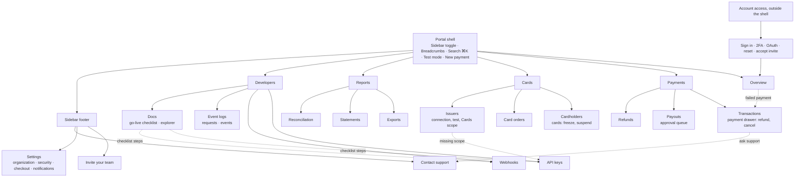

# How we designed Portal

For the product design team. This records how the current version of Portal was reached: where we started, the principles we set, the references we used, each feedback round, and the decisions behind them. It ends with open questions and the research we suggest next.

## Contents

1. [Summary](#1-summary)
2. [Timeline](#2-timeline)
3. [Baseline: the old portal](#3-baseline-the-old-portal)
4. [Principles](#4-principles)
5. [References and the moodboard](#5-references-and-the-moodboard)
6. [The design system](#6-the-design-system)
7. [Feedback rounds](#7-feedback-rounds)
8. [Key decisions and rationale](#8-key-decisions-and-rationale)
9. [Old to new, page by page](#9-old-to-new-page-by-page)
10. [Information architecture](#10-information-architecture)
11. [UX patterns and why](#11-ux-patterns-and-why)
12. [Accessibility decisions](#12-accessibility-decisions)
13. [Responsive decisions](#13-responsive-decisions)
14. [Open questions](#14-open-questions)
15. [Next steps for research](#15-next-steps-for-research)

---

## 1. Summary

Portal is the partner dashboard for The Orange Card's payment orchestration platform: one API in front of Crossmint (card), ForumPay (crypto and payouts) and a blockchain rail (stablecoins), plus a card program with three issuers (Axys, Hypercard, Interlace).

The old portal worked, but it was hard to trust in a payments context: three product names, an ambiguous Live/Sandbox state, all-caps text, orange on everything, and metrics without context. The redesign keeps the brand orange, moves to a calm neutral interface inspired by Gumloop's dashboard, and organises the product by task.

The current prototype has 15 dashboard pages plus the original sign-in page, a token-based design system with light and dark themes, and documentation for backend (`docs/API.md`) and frontend (`docs/FRONTEND.md`).

## 2. Timeline

| Step | What happened | Output |
| --- | --- | --- |
| 1 | Reviewed the old portal | Screenshots in `Last version design/`, design review in `PROJECT_DESCRIPTION.md` |
| 2 | Set principles | Seven principles (section 4) |
| 3 | Design tokens v0.1 | Orange brand tokens, contrast note (`archive/v0/`) |
| 4 | First pass | Single-file Overview prototype with a sidebar (`archive/v0/prototypes/portal-overview.html`); a Figma "Insprations" frame |
| 5 | Moodboard | About 67 Gumloop screens and Resend login references in Figma, measured |
| 6 | Design system v1.0 | Three-tier tokens, no shadows, orange as accent, self-hosted fonts, strict CSP |
| 7 | Login decision | The original login (v0.14) kept untouched; references used for internal pages only |
| 8 | Build-out | Lazy loading with skeletons; all 15 sidebar pages; The Orange Card wordmark |
| 9 | Feedback round 2 | Header, Test mode switch, bottom sheets, animated buttons, flags, card marks, placeholders |
| 10 | Feedback round 3 (current) | Orange primary with a lip, header sidebar toggle, custom dropdowns, avatars, column filters, smooth charts, design system site, right-click menu, these docs |

## 3. Baseline: the old portal

The starting point was the existing Partner Portal (portal-dev), captured in November 2026.

| # | Screen | File |
| --- | --- | --- |
| 1 | Login | `01-login.png` |
| 2 | Merchant overview | `02-overview.png` |
| 3 | Transactions | `03-transactions.png` |
| 4 | Transaction receipt ("Status lookup") | `04-transaction-receipt.png` |
| 5 | Payment sandbox | `05-payment-sandbox.png` |
| 6–8 | Card program: Axys, Hypercard, Interlace | `06-…`, `07-…`, `08-…` |
| 9 | Webhooks | `09-webhooks.png` |
| 10 | API documentation | `10-api-documentation.png` |
| 11 | Developer settings | `11-developer-settings.png` |

### Problems we found

| Area | Problem | Why it matters |
| --- | --- | --- |
| Identity | Three product names: "Digital Asset Center" (login), "PORTAL-DEV Portal", "Partner Portal" | Users are not sure which product they are in |
| Environment | Breadcrumb says LIVE, but the same app has a Sandbox page and a "dev/demo" key override | In payments, people must always know whether real money moves |
| Text | Almost everything is uppercase: nav, labels, buttons, table headers | Nothing stands out; harder to read |
| Colour | Orange used for primary buttons, links, amounts, IDs, warnings and "Rotate" | Actions and data look the same; the primary action is lost |
| Warnings | Orange and amber panels compete with the brand colour | Warnings look like branding |
| Overview | Gross volume has no currency and seems to add USD and USDC; no time range | Numbers cannot be trusted or compared |
| Overview | "64% success rate, Optimal performance" next to "16 out of 49 total" (about 33%) | Metrics contradict each other |
| Overview | Donuts show shares but no values; no trend, recent activity or problems | Nothing to act on |
| Transactions | Request ID (the best lookup key) truncated; order reference takes a wide column; amounts not right-aligned | Lookups are slow |
| Transactions | No date filter, export or visible pagination; failed rows give no reason | Support work needs other tools |
| Receipt | No timeline, failure reason, fees, net amount, provider reference, webhooks, raw payload, copy buttons, refund or cancel | Investigation ends in a dead end |
| Card program | Navigation by issuer; all three pages are the same locked screen asking for a key | Vendor-first navigation, dead ends |
| Developer | Webhooks reachable from two places | Duplicate paths |
| Developer | "Local session API key override" exposed as a product feature; pasting raw keys into the browser | Internal tool shipped to partners; security risk |
| Webhooks | Four buttons per row (Edit, Disable, Rotate, Delete), inline Delete | Visual noise; easy to delete by mistake |
| Webhooks | Event subscriptions shown as a bare `*` | Users cannot see what they subscribed to |
| API keys | No created or last-used dates, no reveal-once secret, no revoke confirmation | Unsafe key lifecycle |
| Users | Finance and admins not served at all (no reports, no team or security) | Two of four user types have no home |
| Login | Left half mostly empty | Weak first impression (later decided to keep the login as is, see step 7) |

## 4. Principles

We agreed on seven principles before drawing anything. Every later decision refers back to them.

| # | Principle | What it means in the UI |
| --- | --- | --- |
| 1 | **Always show the environment** | One Test mode switch in the header and a visible strip in Test mode. No separate Sandbox page |
| 2 | **One primary action per screen** | Orange is reserved for that action. Status uses its own palette (success, warning, danger, info, neutral) |
| 3 | **Sentence case** | No all-caps labels. Uppercase only for codes such as `PAID` and `FIAT_CARD` |
| 4 | **Numbers need context** | Every metric shows currency, time range and change against the previous period, and every rate shows its counts |
| 5 | **Organise by task, not by vendor** | Providers and issuers are filters and columns, not navigation items |
| 6 | **Every ID is copyable, every list is searchable** | Copy buttons on all IDs; a search box on every list; ⌘K across the app |
| 7 | **Destructive actions are confirmed** | They live in overflow menus and open a confirmation that repeats what will happen |

## 5. References and the moodboard

### 5.1 First pass

Before the moodboard we built a single-file Overview prototype with a sidebar to test the principles quickly (now in `archive/v0/prototypes/`), and collected first ideas in a Figma frame named "Insprations". This confirmed the layout (sidebar, page head, KPI row, chart, recent payments) but the visual style was still generic.

### 5.2 The Figma moodboard

The Figma file `Portal-Dashboard`, page *moodboard*, holds:

- **About 67 Gumloop screens.** Chosen because Gumloop's dashboard is calm, dense and readable, with a style suited to a tool people use daily.
- **Resend login references**, for the sign-in flow.

The Gumloop website itself was not reachable during the work, so we did not copy from live pages. Instead, **we measured the screenshots** and turned the measurements into tokens:

| Observation | Measured value | Used as |
| --- | --- | --- |
| Neutral, slightly warm greys | Grey scale steps | `color.neutral.*` primitives |
| Body type | 14px | `type.body-size` |
| Nav item height | 28px | Nav tokens |
| Corner radius | 8–10px | `radius.8`, `radius.10` |
| Separation | 1px borders, no shadows | `border.width`, the no-shadow rule |
| Detail views | Right-side drawers | `Portal.drawer` |
| Filters | Segmented controls with counts | `segmented` component |
| Empty states | Dashed border, icon, one sentence, one action | `empty` component |
| Dark mode | A measured dark palette with clear layer steps, not pure black | `semantic.dark` |

What we kept from Portal rather than the references: the **orange brand accent** and The Orange Card identity.

## 6. The design system

### 6.1 v0.1 tokens

The first token set (`archive/v0/tokens.json`, `tokens.css`) came from a Figma export. It defined the orange brand (`#FF6F00`) and one important rule: **text on orange must be dark**. Near-black (`#171717`) on orange is 6.42:1; white is 2.79:1 and fails WCAG AA. It also stated that Live/Test and status must never rely on colour alone, and that currencies must not be added together without a defined conversion.

### 6.2 v1.0

| Decision | Rationale |
| --- | --- |
| **Three tiers**: primitives, semantic (light and dark), components | A change at one level flows down. Designers can change a role ("primary action") without touching every component |
| **References stay live** (`var()`), with a build script that fails on broken references | Tokens can be tuned in the browser; no silent drift |
| **No shadows** | Matches the references; 1px borders and background steps are clearer in both themes and simpler to keep consistent |
| **Orange as the brand accent**, not the whole palette | Keeps the brand, frees orange to mean "primary action" and "selected" |
| **Status palette** separate from the accent | Warnings no longer look like branding |
| **Inter and JetBrains Mono, self-hosted** | Inter is readable at 13–14px with tabular figures for money; JetBrains Mono for IDs and code. Self-hosting means no third-party requests and a strict CSP |
| **Strict CSP** and no `innerHTML` | Security is part of the design in a payments product |
| **Light and dark** from day one | Developers and operations staff often work in dark mode |

### 6.3 Sign-in kept as it was

The user asked to keep the original login (v0.14) untouched. So `pages/login.html` keeps its own design, and the moodboard references were used for internal pages only. Later rounds added only a demo redirect to Overview after sign-in.

### 6.4 The wordmark

The Orange Card wordmark was rebuilt from Figma as live text: Archivo at 125% width, "THE" above "ORANGE CARD", with a single "O" mark for the collapsed sidebar.

## 7. Feedback rounds

### Round 1: build-out

After v1.0 we built the rest of the product:

- **Lazy loading with skeletons** on every data section, so pages feel fast and nothing jumps.
- **All sidebar pages (15)**: Overview, Transactions, Payouts, Refunds, Cardholders, Card orders, Issuers, Reports, API keys, Webhooks, Event logs, Docs, Team, Settings, Contact support.
- **The Orange Card wordmark** from Figma.

### Round 2

| Feedback | Change |
| --- | --- |
| Titles too large | Page titles reduced to 20px medium |
| Need a proper header | A header with breadcrumbs (section › page), search (⌘K), a Stripe-like **Test mode** switch and a **New payment** button |
| Workspace block in the sidebar adds nothing | Removed |
| Background jumps when overlays open | Fixed scroll locking so the page behind does not shift |
| Overlays feel abrupt | Smoother enter and exit animations, blurred backdrop |
| Drawers awkward on phones | **Bottom sheets** on mobile, with drag to close |
| Buttons feel flat | **Duolingo-style buttons**: a solid bottom edge that sinks on press |
| Copy gives no feedback | Copy buttons show a check and a toast |
| Boxes inside boxes | Removed nested cards; sections separate with spacing and dividers |
| Card brand unclear | **Visa and Mastercard marks** next to issuers and cards |
| Countries as codes | **Country flags** with names |
| Empty inputs give no hint | **Placeholders everywhere**, with realistic examples |
| Support form is a whole page | The Support request is now a **pop-up** (drawer) |

### Round 3 (current)

| Feedback | Change |
| --- | --- |
| Primary buttons should be orange and feel tactile | **Orange primary buttons with a true Duolingo lip** (a darker orange edge that the button presses into) |
| Sidebar toggle hard to find | **Toggle moved to the header**; the collapsed sidebar shows **square items with tooltips** |
| Native dropdowns look out of place | **Custom dropdowns** styled like our menus, keeping the native select underneath |
| Cardholder lists feel anonymous | **Cardholder avatars** |
| Tables need more precise filtering | **Column filters**: text contains, number min/max, date from/to, options; chips for active filters; a bottom sheet on phones |
| Theme switch bug | Fixed: previewing a theme in the design system site no longer changes the app's saved theme |
| Copy feedback still too subtle | **Check icon** on the copy button plus a toast |
| Demo sign-in goes nowhere | **Login redirects** to Overview for the demo |
| Charts feel stiff | **Smooth charts**: area chart in the moodboard style, smooth draw, morph between ranges and hover |
| Design system hard to browse | **Design system site** with a sidebar and every component's states |
| Browser right-click menu is generic | **Custom right-click menu** with actions that fit what was clicked |
| Teams need written guidance | **These docs**: API, frontend and design process |

### Round 4: tactile buttons and polish

| Feedback | Decision |
| --- | --- |
| Follow the tactile button reference (coloured fill with a thick darker lip) | All buttons get a 4px lip, a 12px radius and bold labels. Orange is the main action colour. |
| Gray only for Create payment | A dedicated `btn--neutral` (graphite) is used solely for Create payment and New payment, so the most frequent business action is recognisable everywhere without competing with each screen's orange primary action. |
| Header layout: elements opposite each other | Page title and description on the left, actions on the right, vertically centred. On phones actions stay opposite the title as square icon buttons. |
| Icon-only and square buttons on mobile | Icon buttons drop their visible text on phones. Screen readers still announce the label. |
| Context menu should depend on where you click | The menu is contextual (row, header, value, link, selection, background) and keeps only high-priority actions. Theme switching was removed from it. |
| Login logo alignment | The wordmark moved into the top row, centred and aligned with Back and Partner operations, at a smaller size. |
| "Connected" too large | KPI status text uses 16px. |
| Default scrollbars looked heavy | Thin, rounded, token-coloured scrollbars on both axes. |
| Quota should warn near the limit | The usage meter turns amber at 75% and red at 90%, using design-system status colours. |
| Theme choice | Settings → Appearance: Light, Dark or System (default, follows the device). |

### Round 5: focus the orange, stabilise navigation

| Feedback | Decision |
| --- | --- |
| Remove Create payment from page headers; keep only "+" in the app bar | One always-available "+" (New payment) in the app bar, with no duplicates in page headers. |
| Only page-header buttons should be orange, with white text | Orange marks the page's main action. All other primary buttons are graphite, so orange stays rare and meaningful. White text on orange (orange-600) is the requested style. It is about 3.3:1 contrast, so labels stay bold. |
| API requests meter needs three states | Green under 75%, orange from 75%, red from 90%. |
| The sidebar opened and closed when navigating while collapsed | The collapsed state is applied before the page paints, so the layout stays still between pages. |
| Docs contents list too close to the header | It sticks 24px below the app bar. |
| Remove Light/Dark from the sidebar | Theme lives only in Settings → Appearance. |

### Round 6: motion for change, sorting, pop-up create

| Feedback | Decision |
| --- | --- |
| Content that changes in place (e.g. the Docs explorer endpoint) should animate | One shared fade-and-rise for replaced content, used across drawers, pop-ups, tables, tabs and the explorer. |
| Sorting by highest or lowest should use an arrow | Number and date columns in every table get a header arrow (↕ / ↑ / ↓) that cycles ascending, descending and original order. |
| "+" should open a pop-up, not a side panel | Create payment opens as a centred pop-up. On phones it stays a bottom sheet for reachability. |

## 8. Key decisions and rationale

| Decision | Alternatives considered | Why we chose it |
| --- | --- | --- |
| One name: **Portal** by The Orange Card | Keep "Digital Asset Center" or "Partner Portal" | One name everywhere removes doubt about where you are. The final brand choice is still open (section 14) |
| **Test mode switch** in the header, plus a strip | Separate Sandbox page; environment in the breadcrumb | Matches Stripe, which many developers know. The strip makes Test impossible to miss; Live is the plain default |
| **No Sandbox page** | Keep it next to Test mode | Test mode and the Docs API explorer cover it without a second way to pay |
| **Remove the key override** | Hide it behind a flag | It exposed raw keys in the browser. The explorer uses the session in Test mode instead |
| **Orange primary buttons** with dark text | Black primary buttons (tried during v1.0) | Keeps the brand visible on the one action that matters, at an AA-passing contrast |
| **Neutral interface**, orange only for primary actions, selection and focus | Orange accents across the UI | Principle 2: data and status stay readable |
| **Drawers for details** instead of detail pages | Separate receipt page | The list keeps its filters and scroll; investigation is faster |
| **Issuers as filters**, plus one Issuers page for connection status | One page per issuer | Principle 5. The Issuers page turns the old dead ends into a fix: it explains the missing `CARDS` scope and links to create a key with that scope |
| **Overflow menus** for row actions | Buttons per row | One menu replaces four buttons; Delete moves away from the pointer and is confirmed |
| **Explicit event lists** instead of `*` | Wildcard subscriptions | Users see what they get; new event types are opt-in |
| **Reveal-once secrets** | Show keys any time | Standard practice; limits damage from a shoulder-surf or a leaked screen |
| **Payout approval over 1,000** by a second person | No approval; approval for every payout | Protects larger irreversible crypto transfers without slowing small ones |
| **Success rate with counts** ("32.7%, 16 of 49 payments") | Rate only | Fixes the old 64% vs 16 of 49 contradiction and shows sample size |
| **USD equivalent** totals labelled as such | Summing currencies silently | Honest; the conversion rule is an open question |
| **Sentence case** everywhere | Title case or uppercase | Easier to read, calmer, consistent with the references |
| **No shadows** | Elevation shadows | Cleaner in dark mode; borders carry the structure |
| **Lazy sections with skeletons** | Full-page spinner | Shows structure at once; sections load independently and fail independently |
| **Custom dropdowns over native selects** | Native selects | Visual consistency in both themes; the native select stays underneath for forms and accessibility |
| **Right-click menu** | Browser default | Quick access to copy and open actions on IDs and rows; Shift + right-click still opens the browser menu, and inputs keep it |
| **Static HTML prototype, no framework** | React prototype | Anyone can open and review it; the production team chooses the framework later |

## 9. Old to new, page by page

| Old page | New location | What changed |
| --- | --- | --- |
| Login ("Digital Asset Center") | Sign in (`login.html`) | Kept as the original v0.14 design on request; now redirects to Overview in the demo |
| Merchant overview | Home → Overview | Range control (7, 30, 90 days); volume with currency (USD equivalent), period and change; success rate with counts; paid payments with failed or pending; scrubbable volume chart; share bars with values instead of donuts; recent payments with status filter |
| Transactions | Payments → Transactions | Request ID first and copyable; search by request ID, reference, email or provider reference; status segments with counts; route, method and date filters; column filters; right-aligned amounts with currency; pagination; CSV export |
| Receipt ("Status lookup") | Payment drawer on Transactions | Timeline, failure reason, amounts with fee and net, provider reference, webhooks sent, raw response, copy buttons, refund, cancel, "Ask support" for failures |
| Payments (Sandbox) | Removed | Replaced by the Test mode switch, the header's New payment drawer and the Docs API explorer (Test only) |
| — | Payments → Payouts | New: balances, approval queue, payout timeline, new payout with address validation and network fees, approve, reject, cancel |
| — | Payments → Refunds | New: refund history, KPIs, refund-a-payment flow |
| Card program → Axys | Cards → Cardholders, Card orders (issuer as a filter) | Real lists instead of a locked screen |
| Card program → Hypercard | Same | Same |
| Card program → Interlace | Cards → Issuers | Connection status, test connection, explanation of the missing `CARDS` scope with a link to create the right key |
| — | Cards → Cardholders | New: KYC filters, avatars, flags, profile drawer with cards, freeze and unfreeze, suspend, add cardholder |
| — | Cards → Card orders | New: status timeline, tracking, retry or cancel, new order |
| — | Reports | New: exports, monthly statements, reconciliation of provider settlements |
| Webhooks (two entry points) | Developers → Webhooks (one entry point) | Endpoint count "3 of 10"; event chips instead of `*`; one overflow menu per row; detail drawer with masked signing secret (reveal for 10 s), rotate, deliveries, retry, test event; 7-day success rate |
| Developer settings → API keys list | Developers → API keys | Live/Test filter, scopes, offering restrictions, IP allowlist, created and last used, reveal-once secret, rotate with 24-hour overlap, revoke with confirmation |
| Developer settings → key override | Removed | Security risk |
| Developer settings → redirect URL | Settings → Checkout | Success and cancel URLs with allowed return domains |
| — | Developers → Event logs | New: API request log with masked keys and live tail; events with delivery status |
| API documentation | Developers → Docs | Go-live checklist, offerings table, guides, code tabs (cURL, Node, Python, signature check), API explorer in Test mode |
| — | Team ("Invite your team") | New: members, roles, invites, permissions matrix |
| — | Settings | New: organization, security (2FA, session timeout, IP allowlist, sessions), checkout redirects, notifications, close account |
| — | Contact support | New: request form as a drawer, tickets with threads, system status, contacts |
| — | Header | New: sidebar toggle, breadcrumbs, search (⌘K), Test mode switch, New payment |

## 10. Information architecture

Differences from the IA proposed in `PROJECT_DESCRIPTION.md`:

- **Home** has only Overview. "Getting started" became the go-live checklist on Docs; Alerts became notification rules in Settings.
- **Payment detail** is a drawer, not a page.
- **Balances** sit on the Payouts page rather than as a separate page.
- **Cards** and the program overview are covered by Cardholders (cards in the profile drawer) and Issuers.
- **API explorer** is part of Docs.
- **Team** is in the sidebar footer as "Invite your team", to encourage adding colleagues.

## 11. UX patterns and why

| Pattern | Where | Why |
| --- | --- | --- |
| **Environment switch and strip** | Header, every page | Principle 1. The strip names the consequence ("No real money moves"), not just the mode |
| **Live warning in money flows** | Create payment, new payout | A reminder at the moment of risk |
| **One primary action** | Page head, drawer footers | Principle 2. Users know what the page is for |
| **Review step before money moves** | Create payment, refund, payout, card order | Shows amount, currency, destination, fee and environment before submitting |
| **Confirm with details** | Every destructive action | Repeats the object and the effect ("Requests using this key will fail immediately"); focus starts on Cancel |
| **Overflow menus** | Table rows | Less noise; destructive items at the bottom, in red |
| **Drawers** | All details and create flows | Keep context; deep links reopen them (`?payment=req_…`) |
| **Bottom sheets** | Phones | Reachable with a thumb; drag to close |
| **Segmented filters with counts** | Status filters | Show the shape of the data before clicking |
| **Column filters with chips** | Tables | Precise questions ("amounts over 100 last week") without a query language; chips show what is active and remove with one click |
| **Copyable IDs** | Everywhere | Principle 6. IDs are what support and developers paste |
| **⌘K search** | Everywhere | Paste any ID and jump to it |
| **Timelines** | Payments, payouts, refunds, card orders, cardholders | Answer "what happened and when" in one place |
| **Failure reasons in plain English** | Payment, payout, refund, card order | The old portal showed only "Failed" |
| **Numbers with context** | Overview, KPI strips | Currency, period, change and counts |
| **Empty states with an action** | Every list | Never a blank table; the next step is one click away |
| **Skeletons** | Every data section | Shows the layout at once; no layout jump |
| **Inline section errors with Try again** | Every lazy section | One failing section does not break the page |
| **Reveal-once secrets** | API keys, new webhook endpoints | Security by default |
| **Save bar** | Settings | One save for all tabs; clear unsaved state; discard option |
| **Placeholders with real examples** | All inputs | Show the format (`ORD-10493`, `25.00`, `TQn9Y…`) |
| **Validation on submit with specific messages** | All forms | Less noise while typing; messages say how to fix it |
| **Toasts for success** | After actions | Quiet confirmation; errors stay inline |
| **Tactile buttons** | Primary and danger buttons | The lip makes the main action feel physical and obvious |
| **Right-click menu** | Dashboard pages | Fast copy and open actions for power users |
| **Payout approval by a second person** | Payouts | Four-eyes check on large irreversible transfers |
| **Go-live checklist** | Docs | Turns onboarding into four concrete steps |

## 12. Accessibility decisions

- **Contrast**: dark text on orange (about 6.4:1). Status colours have text badges, so colour is never the only signal. Both themes target WCAG 2.1 AA.
- **Sentence case** improves readability for everyone, including people with dyslexia.
- **Keyboard**: every control is reachable with Tab; segmented controls, tabs, menus, the custom dropdown and the chart scrubber work with arrow keys; Esc closes every overlay.
- **Native `<dialog>`** for drawers, confirms and the palette, so focus is trapped and returns to the opener.
- **Safe defaults**: destructive confirms focus Cancel first.
- **Labels**: every input has a visible label; icon buttons have names; table rows that open drawers say what they open.
- **Live regions**: toasts are polite; section errors use `role="alert"`; loading sections use `aria-busy`.
- **Charts** have a text readout and keyboard scrubbing.
- **Tooltips** on the collapsed sidebar appear on focus as well as hover.
- **Reduced motion** turns off count-ups, chart drawing, slides and shimmer.
- **Flags** have accessible country names, or are hidden when the text already names the country.

Not yet verified: a full screen reader pass (VoiceOver, NVDA) and an automated axe scan.

## 13. Responsive decisions

| Width | Behaviour | Why |
| --- | --- | --- |
| > 1100px | Full layout, KPI rows, two-column grids | Desktop is the main context for operations and finance |
| ≤ 1100px | KPI strips and grids stack | Avoid cramped numbers |
| ≤ 860px | Sidebar becomes a drawer opened from the header toggle | One toggle in the same place at every size |
| ≤ 600px | Drawers become bottom sheets; tables become labelled stacked rows; column filters open in a sheet | Thumb reach; no sideways scrolling |

Rules: no horizontal page scroll at 390px; long values wrap or truncate with an ellipsis and stay copyable; the header keeps search, Test mode and New payment reachable on phones.

## 14. Open questions

From `PROJECT_DESCRIPTION.md` and the work since:

1. **Metric definitions.** How exactly are success rate and gross volume calculated? Which statuses count, and how are USD, USDC, USDT and AED combined? The prototype labels totals as "USD eq." until this is agreed.
2. **Roles.** Which roles and permissions does the backend support today? The design assumes Admin, Developer, Finance and Viewer, with Finance never seeing API keys, and payout approval by Admin or Finance.
3. **Test mode backend.** Is Test mode backed by separate test keys and data on the API side? The design assumes full separation.
4. **Design system ownership.** Should Portal follow The Orange Card design system, or have its own neutral identity (for example "Digital Asset Center")? Today it uses The Orange Card wordmark and orange accent on a neutral, Gumloop-inspired system. Who owns the tokens going forward?
5. **Login.** The original login is kept unchanged. Should it move onto the design system later?
6. **Payout threshold.** Is 1,000 per payout the right threshold, and should it be configurable?
7. **Alerts.** Where do in-app alerts appear (the bell is in the icon set but not built)?

## 15. Next steps for research

| Study | Method | Participants | Questions |
| --- | --- | --- | --- |
| **Column filters** | Moderated usability test on the prototype, 5–6 sessions | Operations and support staff | Do people find the header filter button? Do they understand text contains vs options vs ranges? Do chips make active filters clear? How do they combine toolbar and column filters? On phones, is the "Filter columns" sheet found? |
| **Payout approval** | Task-based test plus interviews | Finance staff and admins | Is it clear why a payout waits? Do requesters understand they cannot approve their own? Is the confirmation information (destination, network, fee, recipient gets) enough to approve safely? Is 1,000 the right threshold? |
| **Go-live checklist** | Unmoderated test with think-aloud, then a first-click test | Developers new to the platform | Can a developer complete the four steps without help? Is "Request go-live" understood as a review, not an instant switch? What is missing (for example, which test cases the reviewer checks)? |
| **Test mode** | Observation during the above tests | All | Do people always know which mode they are in? Does the strip get noticed? |
| **Overview metrics** | Comprehension test with variations | Operations, finance | Do "32.7%, 16 of 49 payments" and "USD eq." read correctly? Which comparisons do people want? |

Measure: task success, time on task, errors (especially acting in the wrong environment), and confidence ratings. Feed the results back as changes to the prototype and to `docs/API.md` where the backend is affected.
